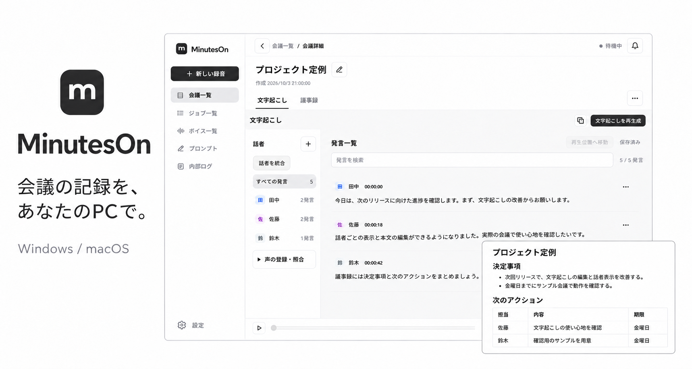

# MinutesOn



<sub>画面内の会議は公開用のサンプルデータです。</sub>

**会議の記録を、あなたのPCで。**

MinutesOn（略称 **mon**）は、会議の録音・文字起こし・話者分離・議事録生成をローカルで行う、Windows／macOS向けデスクトップアプリです。AIモデルの導入後は、録音した会議や取り込んだ音声をオフラインで解析できます。

現行の **1.0.1を完成版**として、今後は不具合修正と保守を中心に扱います。署名済み配布物・Store公開・品質評価の確認状況は[製品概要](docs/spec/overview.md#配布と評価の確認状況)にまとめています。

## 主な機能

| 機能 | できること |
| --- | --- |
| 会議を録音 | マイクとPC音声、録音前の5秒テスト、録音中のミニパネル |
| 音声を取り込む | WAV・MP3・AAC/ALAC M4A・FLACから会議を作成 |
| 文字起こし | ローカルAIでテキスト化し、再生しながら本文を修正 |
| 話者を整理 | 話者ごとの区間分離、名前・割当ての修正、声の登録・照合 |
| 議事録を作る | Markdownの生成・プレビュー・テキスト編集・保存・出力 |
| 用語を登録 | 共通・会議別の用語を文字起こしのヒントに使用 |
| データを管理 | 手動バックアップ、追加復元、会議保存先の変更 |
| 表示を選ぶ | モノトーン／パープル、システム／ライト／ダーク |

## 対応環境

| OS | 対象 |
| --- | --- |
| Windows | Windows 11 24H2以降・x64 |
| macOS | macOS 15以降・Apple Silicon |

初回のモデル取得にはネットワーク接続と空き容量が必要です。処理時間・メモリ使用量・精度は端末、モデル、音声に依存します。モデルの選択肢と実行方式は[モデル仕様](docs/spec/models.md)を参照してください。

## 使い始める

1. [macOS](docs/guides/build-macos.md)／[Windows](docs/guides/build-windows.md)の手順でアプリを準備します。配布経路は[ドキュメント目次](docs/index.md)から確認できます。
2. 「設定 → ローカルAI」で各モデルを選び、「ダウンロードして使用」で導入します。
3. 「新しい録音」の5秒テストで入力を確認してから録音するか、保存済み音声を取り込みます。
4. 発言の本文と話者を修正し、議事録を生成・編集・出力します。

詳しい操作は[使い方](docs/guides/usage.md)を参照してください。議事録の再生成では旧版を自動保存しないため、必要な本文は事前に出力してください。

会議情報と音声はPC内に保存します。Windows・macOSとも、録音・取り込みが正常完了した会議の音声は16kHz・16bit・モノラルのWAV 1ファイルにまとめ、管理領域内の不要な元音声・変換途中の音声を整理します。取り込み元のオリジナルファイルは変更・削除しません。モデルの初回取得は外部配布元へ通信します。内部ログには会議本文やローカルパスが含まれる場合があり、会議とは別の期限で保持されます。[保存とプライバシー](docs/spec/storage.md)を確認してください。

## 開発と保守

Node.js 24、Rust stable、Python 3.12とOS別の開発環境が必要です。

```sh
git clone https://github.com/s-kodani/mon.git
cd mon
npm ci --prefix app
npm --prefix app run tauri -- dev
```

このコマンドは画面とRust本体の開発起動です。録音ヘルパー・推論ランタイムの準備はOS別ビルド手順に従います。通常の開発起動は通常版と同じ保存設定を使うため、既存データを分けて検証するときはQA版を使用してください。

- [ドキュメント目次](docs/index.md)：利用・保守の入口
- [現行仕様](docs/spec/index.md)：現在の動作とアーキテクチャ
- [利用と保守](docs/guides/index.md)：ビルド・配布・更新・障害対応・テスト
- [ADR](docs/adr/index.md)：設計判断と理由

不具合報告や改善提案は[Issues](https://github.com/s-kodani/mon/issues)、修正はPull Requestで受け付けます。OS・モデル・再現手順・期待した動作と実際の動作、実行した検査を記載してください。大きな変更は先にIssueで目的と範囲を共有し、変更に合わせて仕様・手順・ADRを更新します。ログ・画像・音声の共有前に会議本文や個人情報等を確認してください。

## ライセンス

本体のライセンスは未設定です。リポジトリルートに`LICENSE`はありません。依存ライブラリとAIモデルにはそれぞれの利用条件が適用されます。[第三者ライセンス資料](third-party/notices/README.md)と[モデル定義](app/model-catalog/)を参照してください。
