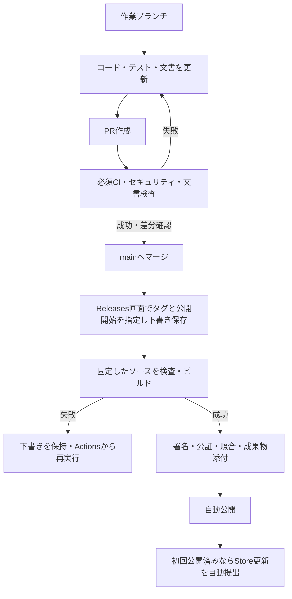

# GitHubでの開発とリリース

## 開発の流れ

`main`から作業ブランチを作り、コード・テスト・関連文書を同じPRで更新します。作業中の変更がある場合は専用worktreeで分け、他の変更を混ぜません。

1. 不具合・目的に対応するブランチを作成します。名前の例は`fix/audio-import`や`chore/dependencies`です。
2. 実装・テストと、変更した仕様・操作・制約の文書を更新します。
3. ブランチをpushし、`main`向けPRを作成します。変更後の動作、実行した検査と結果、未実施の検証、文書更新の有無と理由を記載します。
4. `CI gate`と`Security gate`が成功したことを確認します。検査失敗・取消・必要な検査の未実施を成功扱いにしません。低・中程度の報告も確認します。
5. 差分を確認してマージします。保守担当者1名の運用では承認数を0にし、本人が自分のPRを確認してマージします。mainへのマージだけでは公開しません。

Dependabotは月曜10:00（日本時間）に更新PRを作成します。自動マージはせず、通常のPRと同じ検査・確認を通します。定期検査で見つかった問題も作業ブランチとPRで修正します。



## PR・日次・リリース前の検証

PRとmain更新では、変更範囲に応じて通常のRustテスト、共通クレート、Python、画面・ブラウザーを検査します。通常Rustは最大2プロセス×4スレッドで実行し、CPU数の少ないCIでも同時実行を8スレッド以内に抑えます。全検証の既存の並列設定は変更しません。文書のみの変更では既存の判定に従ってネイティブ・ブラウザーを省略します。WindowsのQAインストーラー・MSIX、Swift録音プローブ、準備済みネイティブ資材を使う連携と重いRustテストは、PRごとには実行しません。

[Desktop daily validation](../../.github/workflows/desktop-daily.yml)は毎日04:17（日本時間）に、固定したコミットで両OSの全件検証と配布物の検証を実行します。開始はGitHubの混雑で遅れる場合があります。日次検証から公開・署名・Store提出は行いません。失敗はActionsの結果と診断成果物から確認します。

Actionsの**Desktop platform validation → Run workflow**では`quick`または`full`を選びます。既定は`full`です。`full`は重い検証とQA/MSIXの作成を含み、通常側の成功を全件成功と読み替えません。`CI gate`は実行モードで必要な検証の成功を要求し、失敗・取消・意図しない省略を拒否します。

リリース前は、日次の成功結果を流用せず、公開対象の固定SHAに対して`full: true`で全検証を行います。PRの軽量化によってリリース前の条件を緩めません。セキュリティ検査と`Security gate`は別経路のままです。ローカルのコマンドとテスト分類は[テストガイド](testing.md)を参照してください。

## 文書を同じPRで更新する

開発フローの正本はこの文書、検査・資格情報・例外管理の正本は[DevSecOps運用](devsecops.md)です。OS固有の配布処理は各配布ガイドを参照します。PRの「ドキュメント」欄に更新先、または不要の理由を書きます。CIはOKF形式、リンク、アンカー、参照先、目次からの到達性を検査し、本文と実装の意味の一致は実装担当者が確認します。

## Releases画面でバージョンタグを管理する

[初期設定](devsecops.md#自動配布の初期設定)を済ませてから利用します。バージョンタグはGitHub Releases画面で指定します。ローカルでタグを作成・pushする操作を通常手順に含めません。

1. `app/package.json`、同ロックファイルのルート版、Tauri設定、Rustの`mon-desktop`パッケージの版を揃えるPRをmainへマージします。共通ライブラリの独立した版番号まで揃える必要はありません。
2. GitHubのReleases → **Draft a new release**を開き、タグ`vX.Y.Z`を指定します。新規タグの場合は**Create new tag**を選び、Targetを`main`にします。通常の安定版として作成します。
3. リリースノートを書き、次の行を本文の独立した行として追加して**Save draft**で保存します。

```text
- [x] 自動公開を開始
```

4. 約5分間隔の検出処理が対象コミットを固定し、リリースIDごとのビルドを開始します。GitHubのスケジュールは混雑等で遅れる場合があります。
5. 検査、ビルド、DMG署名・公証、EXE未署名確認、MSIX照合、SBOM・来歴証明の生成が成功すると、成果物を添付して自動公開します。実機確認や追加の手動承認は公開の必須条件にしません。

**Publish releaseボタンを先に押さないでください。** 下書きの本文・タグ・対象を途中で変更した場合は公開直前の照合で中止します。本文末尾の`mon-release`コメントは処理状態です。通常は編集しません。公開済みタグ・バイナリは置き換えず、修正は新しい版で公開します。

Windows EXEは未署名であり、配布名と説明にも明記します。Store用の未署名MSIXはActionsの成果物として保持し、直接インストール用としてReleasesへ公開しません。実機確認・ライセンス審査等の未確認項目は、配布成功後も未確認として残します。

## 失敗・試行・再実行

失敗時は下書きが残り、Actions実行へのリンクを記録します。原因を修正し、Actionsの**Release build**から再実行します。自動で無制限に再試行しません。対象ソースを変える必要がある場合は新しい版のPRからやり直します。

アップロード途中で失敗して添付物が残った場合は、下書きの添付物をすべて削除してから再実行します。公開済みの添付物は削除・置換しません。claim前に失敗した場合、版・開始指定・Targetを修正して検出を待ちます。dispatchに失敗した場合は、下書き末尾の状態コメントを削除して再度保存し、検出をやり直します。

公開しない試行では、claim済みのリリースIDと固定SHAを指定して、main上の**Release build → Run workflow**を`dry_run=true`で実行します。署名・公証と証明生成は行いますが、Releasesの公開とStore提出は行いません。`verified-release-preview`で添付予定ファイルを確認します。

Storeの提出と一般公開完了は別の状態です。初回公開とAPI設定の完了後に自動提出を有効化します。提出後は定期処理が状態を追跡し、失敗時は[Store手順](distribution-store.md)に従って同じ提出IDから再開します。
