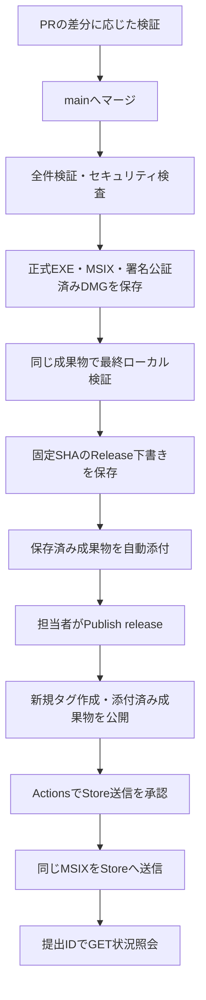

# GitHubでの開発とリリース

## 開発の流れ

最新の`main`から作業ブランチを作り、コード・テスト・関連文書を同じPRで更新します。作業中の変更がある場合は専用worktreeで分け、他の変更を混ぜません。

1. 目的に対応するブランチを作成します。例は`fix/audio-import`や`perf/ci-artifact-promotion`です。
2. 実装・必要なテストと、変更した仕様・操作・制約の文書を更新します。
3. ブランチをpushし、`main`向けPRを作成します。変更後の動作、検査結果、未実施の検証、文書更新先を記載します。
4. `CI gate`・`Security gate`の成功と差分を確認してマージします。保守担当者1名の運用ではPR承認数を0にし、本人が確認してマージします。
5. mainの正式ビルドを手元で検証してからReleaseを下書きします。mainへのマージでは公開しません。

Dependabotは毎週月曜10:00（日本時間）に更新PRを作成します。[DevSecOps運用](devsecops.md#githubの初期設定)の条件と通常のPR検査を通し、担当者が取り込みます。

## PR・日次・リリース前の検証

PRは変更した経路の検査だけを実行します。最終ゲートは常に完了し、実行予定の失敗・取消・省略、変更範囲の判定失敗を拒否します。

| PRの変更 | 実行する主な検査 |
| --- | --- |
| `docs/`・README等のみ | 文書・秘密情報・ワークフロー方針・最終ゲート |
| フロントエンド | フロントエンド／両OSのブラウザー・JS/TS CodeQL |
| Rust・共通コア | 通常ネイティブ・該当言語CodeQL |
| IPC契約・生成契約・プラットフォーム設定 | フロントエンドとネイティブ・該当言語CodeQL |
| Pythonツール・テスト | Python・Python CodeQL。native CIやruntimeの準備ツールでは対応するネイティブ検査も実行 |
| 依存・ワークフロー・未分類ファイル | 関係する検査。未分類・ワークフローは全経路 |

正本は[変更範囲判定](../../tools/mon_ci_scope.py)です。削除を含め、renameは削除＋追加として両方を判定します。アプリ同梱Markdown、第三者通知は文書だけの変更に分類しません。

通常Rustはライブラリのテストを最大2プロセス×4スレッドで実行します。0件のバイナリテスト・doctestのための追加コンパイルを省き、実行ファイルのリンクは正式パッケージ生成で確認します。全件検証のスレッド設定は維持します。

mainのコード変更は[Main build](../../.github/workflows/release-build.yml)に集約し、全件Rust・Swift／Windows連携・実モデル・フロントエンド・セキュリティと最終パッケージ生成を一度実行します。EXEとMSIXは、資材を準備した同じWindows jobで順に作ります。macOSは検証jobで最終アプリを準備し、資格情報を持つ別jobで署名・公証します。文書だけの変更では軽い検査だけを行い、配布物を生成しません。

同じSHAに対する日次ネイティブ全件実行は廃止し、[Desktop full validation](../../.github/workflows/desktop-daily.yml)の手動実行を残します。[Security validation](../../.github/workflows/security.yml)の日次検査は毎日09:30（日本時間）に継続します。公開時にテストやビルドを再実行しません。

Actionsの**Desktop platform validation → Run workflow**では`quick`／`full`を選びます。既定は`full`で、QAインストーラー・MSIXの内容検証を含みます。この診断用実行はバイナリを配布せず、JSON証跡と診断を残します。ローカルのコマンド・分類は[テストガイド](testing.md)を参照してください。

## 文書を同じPRで更新する

開発フローの正本はこの文書、資格情報とGitHub設定の正本は[DevSecOps運用](devsecops.md)です。OS固有の配布処理は各配布ガイドを参照します。PRに更新先または不要の理由を書きます。CIはOKF形式、リンク・アンカー、参照先、目次到達性を検査し、実装との意味の一致は担当者が確認します。

## Releases画面でバージョンタグを管理する

[初期設定](devsecops.md#自動配布の初期設定)後、次の手順で公開します。

1. `app/package.json`、同ロックファイルのルート版、Tauri設定、Rustの`mon-desktop`の版を揃えたPRをmainへマージします。例は`1.2.3`です。
2. そのコミットの**Main build**が成功するまで待ちます。全件検証済みの正式DMG・EXE・MSIXを作成し、manifest・SBOM・SHA256SUMS・来歴証明とともにActionsに30日保存します。MSIX原本はStore送信用の`release-store`で保持し、Releasesの一般公開には含めません。
3. 実行サマリーの「最終ローカル検証用の配布物」からダウンロードして手元で確認します。署名・公証済みDMGと正式EXEをそのまま使います。MSIXの手元での確認は[同一原本からのローカル検証](distribution-store.md)に従い、送信には未署名原本を使います。
4. 同サマリーの「このコミットのRelease下書きを作成」を開きます。`v1.2.3`と確認した完全SHAが入力されています。ノートを編集して**Save draft**します。開始チェックボックスは不要です。
5. 約5分間隔のcontrollerが保存済み成果物を下書きへ添付します。GitHubのスケジュールは混雑で遅れる場合があります。急ぐ場合は**Release draft controller → Run workflow**をmainで実行します。再ビルド・再署名は行いません。
6. 添付完了と対象SHAを確認して**Publish release**を押します。新規タグはこの公開時に作成され、添付済みのバイナリが公開されます。ローカルでのタグpushを通常手順に含めません。タグをpushするだけではReleaseを公開しません。
7. **Microsoft Store submission**がmainで承認待ちになります。Actions → 対象実行 → **Review deployments** → `release-store` → **Approve and deploy**で承認すると、同じmain実行のMSIXを送信します。却下した場合は送信しません。

Targetを`main`にして手動作成した下書きは、最初の検出時のSHAへ固定します。手元で確認したコミットからmainが進んでいる可能性があるため、通常はサマリーのリンクを使ってください。既存タグを選んだ場合は実際のタグの解決先を採用し、そのSHAの保存済み正式ビルドを要求します。

状態コメント`mon-release`には添付したrun・attempt・artifact IDを保持します。来歴の証明にはGitHub attestationを使います。ノートの編集は可能ですが、対象SHAやタグ、添付したバイナリは途中で差し替えません。Windows EXEの未署名や、実機確認・ライセンス審査等の未確認項目を、CI成功だけで確認済みとしません。

## 失敗・試行・再実行

mainビルドに失敗した場合は原因を確認し、**Re-run failed jobs**で該当検査・生成を再開します。成功済みの同一SHAの候補は通常の再実行で上書きしません。コード修正は新しいmainコミットで作成し、手元の確認もその成果物で行います。

添付の通信失敗はcontrollerの次回実行で再開します。同名・同サイズ・同SHAの添付物は省略し、欠けた物だけを追加します。異なる添付物や予期しない添付物がある場合は停止し、自動削除・上書きはしません。対象が公開済みになった場合も操作を停止します。

成果物の不足・期限切れ・SHA不一致では下書きの添付を停止します。最新mainや別runへの自動切替、リリース時の再ビルドは行いません。新しい候補でやり直す場合は、明示的に新しいmainビルドと手元の確認から進めます。公開済みタグ・バイナリの修正は新しい版にします。

Store送信の中断は[Store更新の再開](devsecops.md#store更新の有効化と再開)に従います。定期処理は既存の提出IDの状態だけを照会し、`PendingCommit`でも送信を再開しません。再送信には対象IDを指定した手動実行と承認が必要です。

## 削減効果の見積もり

2026-11-13の調査値を基準にした計画上の予測です。下記は同じrunner・依存キャッシュ条件でのCI比較を完了した実測値ではありません。コンパイル時間とテスト実行時間を分けて評価します。

| 対象 | 変更前の調査値 | 変更後の目安 | 短縮の目安 |
| --- | ---: | ---: | ---: |
| 通常macOSのnativeステップ | 25.2分 | 20〜23分 | 2.2〜5.2分、9〜21% |
| 通常Windowsのnativeステップ | 14.8分 | 10〜12分 | 2.8〜4.8分、19〜32% |
| 全件macOSのnativeステップ | 36.7分 | 30〜35分 | 1.7〜6.7分、5〜18% |
| 全件Windowsのnativeステップ | 58.8分 | 50〜56分 | 2.8〜8.8分、5〜15% |
| Release下書きへの添付 | 約91分の検査・生成を含む旧フロー | 添付1〜5分＋検出待ち | 検査・生成はmainへ移動 |

テスト実行部分だけでは15〜30%削減を予測します。0件doctestの追加コンパイルは調査時に各OS約136秒でした。バックアップの入力生成共有、重複する成功復元と障害注入行列の削減の根拠は[残す保証の対応表](testing.md#重複削減と残す保証)に記載します。

新しいmain全体は全件検証と正式パッケージ生成を含むため、約60〜80分を粗い目安とします。旧mainの通常検証と単純比較しません。旧リリースの約91分が総CI時間からそのまま消えるわけではありません。日次の重複停止・公開時の重複検査停止・PRの範囲別実行で、不要な実行回数も減らします。

導入後は各OSで通常／全件を同じrunner・キャッシュ条件で各1回比較し、計測ノイズが大きい場合だけ追加します。`rust-tests-*`のコンパイルと実行の内訳、Windows準備・パッケージ生成の内訳、公開までの待ち時間を確認します。

この変更のローカル確認では、macOSでバックアップ162件（実行約63.5秒、コンパイル約419秒）と再確認・障害回復87件（実行約94.6秒、コンパイル約0.5秒）が成功しました。ビルドキャッシュ条件が異なるため、これらから上表の削減率を実測済みとは扱いません。Windows・署名公証・Actions上の全件所要時間は導入後の確認です。
