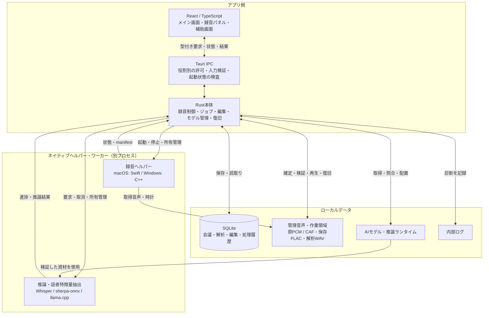
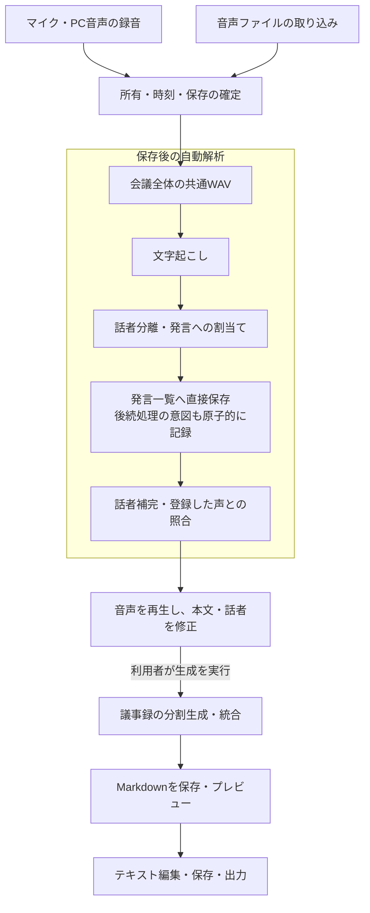
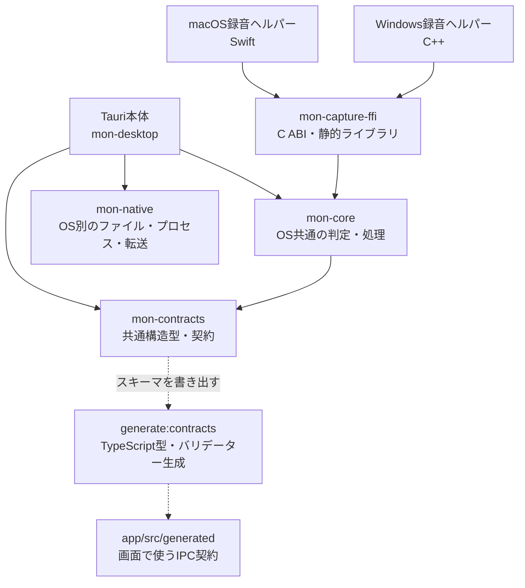

# アプリの構成と処理境界

## 構成

アプリ側が操作受付・ジョブ・保存を管理し、録音と推論は別プロセスのヘルパーへ委ねます。矢印は主な呼出しとデータの受渡しを表します。

| 領域 | 役割 |
| --- | --- |
| `app/src` | React／TypeScriptの画面、編集状態、通知、生成IPCの利用 |
| `app/src-tauri` | Tauri本体、永続化、ジョブ、操作受付、モデル管理、OS連携 |
| `crates/mon-core` | OSに依存しない録音・モデル・メディア等の共通判定 |
| `crates/mon-native` | OS別のファイル・プロセス・転送などのネイティブ境界 |
| `crates/mon-contracts` | 共通の構造型・契約 |
| `crates/mon-capture-ffi` | 録音のFFI連携 |
| `probes` | Swift／C++の音声取得、推論ワーカー、声の特徴量ヘルパー |
| `tools` | 資材準備、契約生成、配布、テスト・評価ツール |

Rust workspaceと`Cargo.lock`をルートで共有します。録音・解析・データ操作の成功判定はネイティブ側で行い、画面だけで保存済みと推測しません。

## 処理の流れ

各処理は開始時の固定入力と操作IDを持ち、取消・異常終了・再開・公開時の編集競合を検査します。文字起こしやモデル設定の変更だけでは議事録を自動生成せず、明示的な再生成では置換を確認します。

## 共通処理とコード生成

実線はライブラリの依存先、点線はビルド時のコード生成を表します。録音ヘルパーはC ABIを通じてRustの共通判定を使い、Tauri本体と判定を共有します。

## IPCとウィンドウ

IPC型・バリデーターは契約定義から生成します。`npm --prefix app run generate:contracts`で生成し、`check:contracts`で整合性を確認します。コマンドと各ウィンドウの許可は[コマンド登録](../../app/src-tauri/command_registry.json)と[Tauri capabilities](../../app/src-tauri/capabilities/)を参照します。

メイン、録音パネル、録音説明、終了確認は別の役割と許可を持ちます。WebViewへ汎用シェル・任意ファイル操作を公開しません。起動診断時は通常の画面と操作を開始せず、診断の読取り・終了・再起動と、専用の受付条件を満たす明示的な初期化操作を提供します。画面ごとの関係は[画面構成と遷移](screens.md)、保存データの関連は[ER図](data-model.md)を参照してください。

## ネイティブプロセス

録音・推論ヘルパーは同梱パスと必要な資材を検証して起動します。Windowsの推論などはJob Objectで所有し、取消・親終了時に配下の終了を管理します。macOSでも所有する子の停止・確定を待ちます。モデルから得た任意のコマンドをシェルで実行しません。

通常版とQA版は起動識別子・保存設定を分離します。同一版を再度起動した場合は既存のメイン画面を表示し、後発プロセスは終了します。アプリ・ヘルパー・ランタイムは同じソースから揃えて構築します。

設計の理由は[ADR](../adr/index.md)、変更時の確認は[テスト運用](../guides/testing.md)を参照してください。
