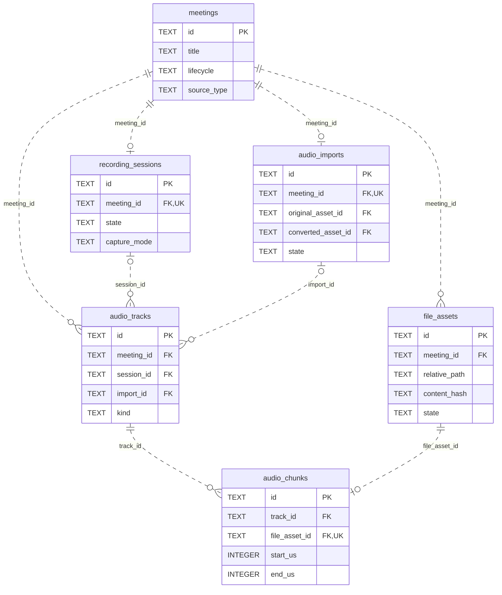
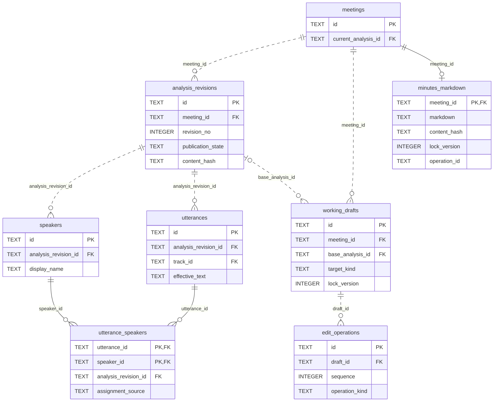
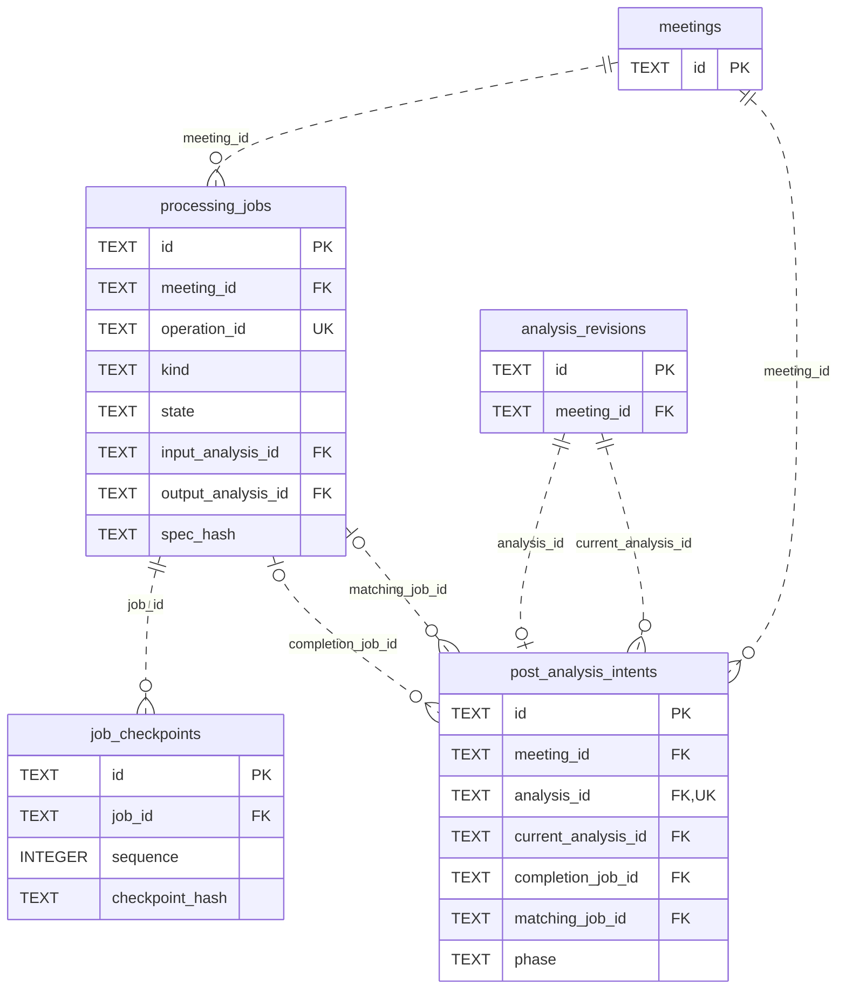
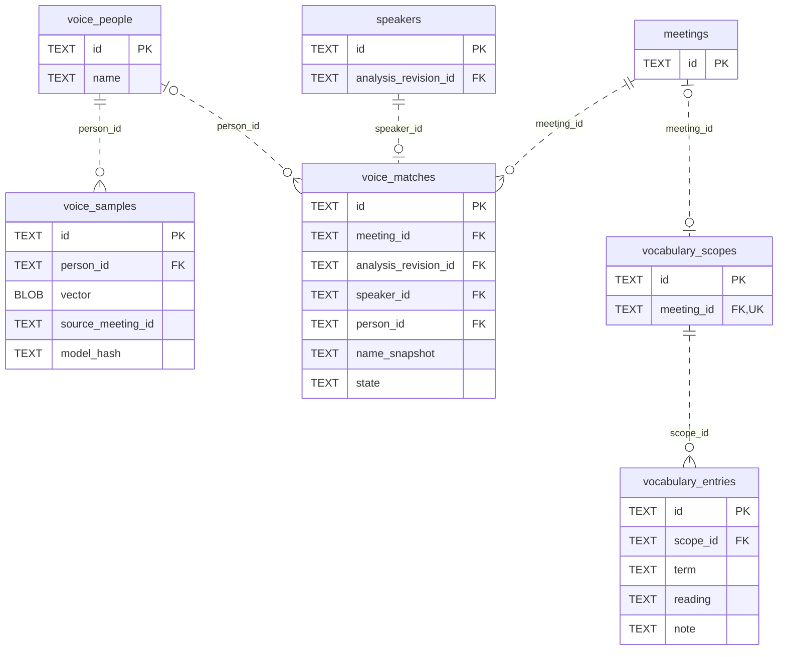

# データモデルとER図

DB schema 38の主要テーブルを領域別に示します。テーブル・列は物理名で、PKは主キー、FKは外部キー、UKは一意制約です。関連線は実際の外部キーに基づき、`||`は1、`o|`／`|o`は0または1、`o{`は0以上を表します。実線は親のキーを子の主キーに含む識別関連、点線は非識別関連です。

列は代表項目に絞り、複合外部キーの会議ID・解析版IDの照合、CHECK制約、索引、トリガー、補助台帳は省略しています。完全な定義は[マイグレーション](../../app/src-tauri/src/migrations/)を参照してください。ファイルの所有・保存・復旧の動作は[保存仕様](storage.md)が正本です。

## 会議と音声資産

会議には録音または取り込みの由来を持たせます。各トラックの`session_id`と`import_id`はどちらか一方だけを指定します。`audio_imports`の原本・変換済み資産も`file_assets`を参照します。チャンクと管理ファイルは一意に対応し、ファイルの実体はDB外の管理領域に置きます。時計対応・欠損は`track_clock_segments`・`audio_gaps`に別途記録します。

## 解析と編集と議事録

解析版は発言と話者を保持し、`utterance_speakers`で一つの発言に複数話者を割り当てます。会議の`current_analysis_id`が現在版を指し、手動編集中の内容は`working_drafts`と`edit_operations`で管理します。発言は元のトラックも参照します。

現在の議事録の正本は会議ごとに最大1件の`minutes_markdown`です。DBには過去の構造化形式の`minutes_revisions`・`minutes_items`・`evidence_links`も残りますが、現行UIの議事録版復元や根拠管理を表すものではありません。[議事録仕様](minutes.md)を参照してください。

## ジョブと後続処理の意図

`processing_jobs`が固定入力・実行条件・操作IDを持ち、`job_checkpoints`が進捗の確定点を保持します。入力・出力解析版や再試行元ジョブへの参照も持ちます。

解析結果の保存時に`post_analysis_intents`を同じトランザクションで記録します。元の`analysis_id`は一意で、補完後の現在版と補完・照合のジョブIDを別に保持し、再起動後も同じ意図を確認します。

## 登録した声と用語

人物と登録特徴量は会議内の話者から独立しています。`voice_samples.source_meeting_id`等は由来の値として保持し、会議への外部キーにはしません。元音声を削除しても登録特徴量と独立保存した登録音声は残ります。`voice_sample_audio.id`は`voice_samples.id`への外部キーで、保存パス・容量・SHA-256・フレーム数・保存状態を管理します。登録区間の削除で音声管理行も削除し、ファイル削除は端末内の`voice_audio_operations`に記録して回収します。人物削除後は照合記録の`person_id`をNULLにし、名前のスナップショットを保持します。

用語のスコープは`global`と会議別です。共通スコープだけは`meeting_id`を持たず、各会議には最大1件のスコープを作ります。実行時に固定する辞書内容は別の`vocabulary_snapshots`に保持します。

モデルパッケージ・端末設定・復元・削除の台帳など、図で省略した領域は[モデル仕様](models.md)・[保存仕様](storage.md)とマイグレーションを参照してください。
