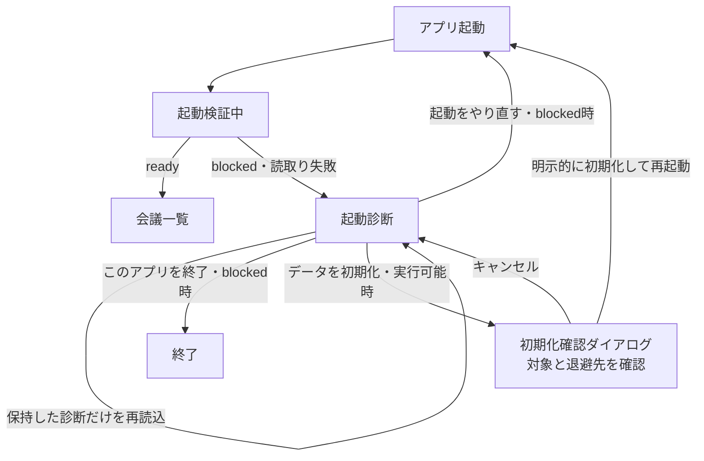
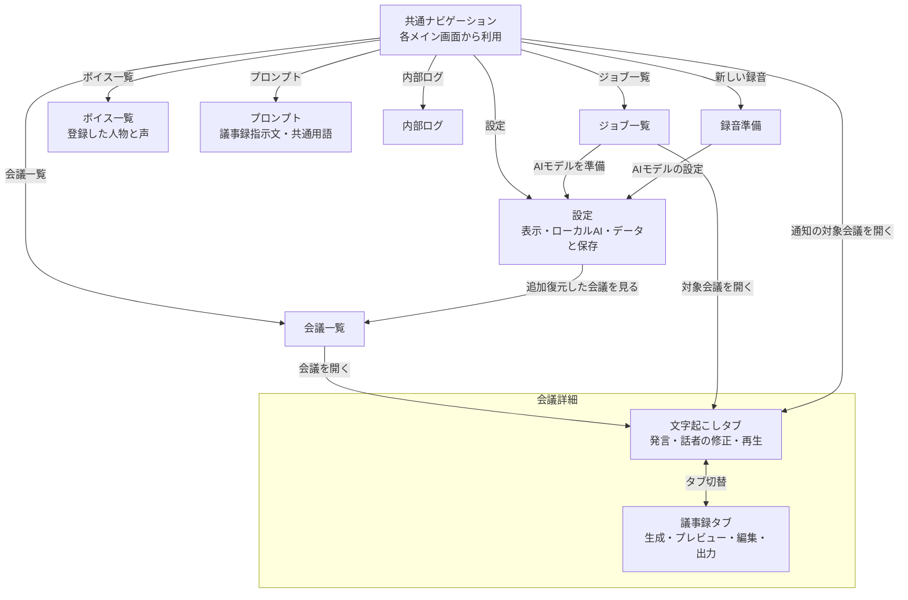
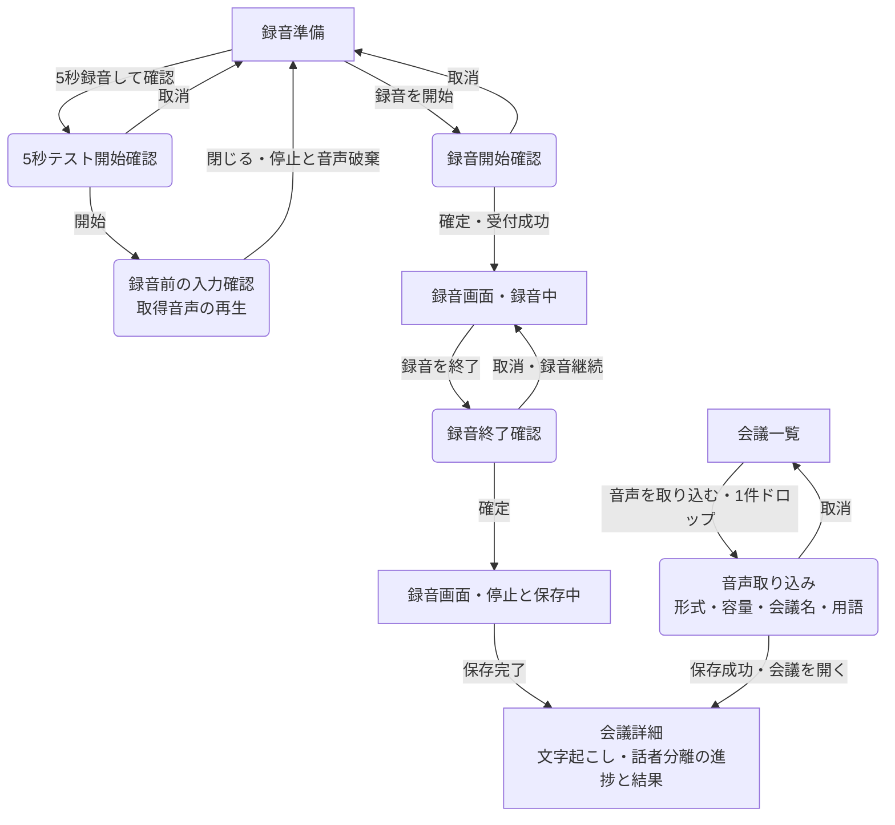
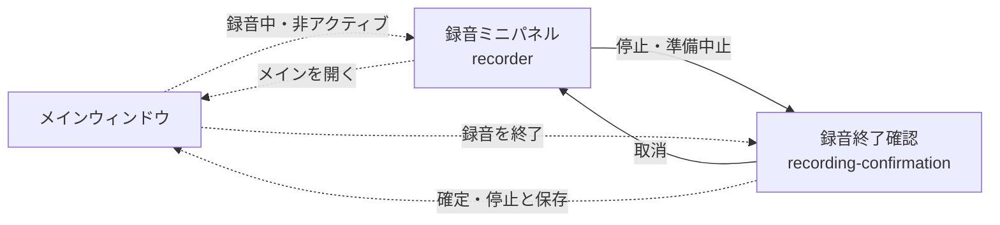

# 画面構成と遷移

メインウィンドウ内の画面切替と、ダイアログ・別ウィンドウの表示を分けて示します。矢印のラベルは操作または遷移条件です。録音の準備・録音中・保存中は、同じ録音画面内の表示状態です。基本操作は[使い方](../guides/usage.md)を参照してください。

## 起動と診断

`ready`を確認するまで通常画面を開きません。診断の再読込みと、プロセスを再起動して保存先を検査し直す操作は別です。初期化は会議・音声・文書・モデル・設定を対象とする明示操作で、自動修復ではありません。退避を選んでもモデル本体と取得途中のモデルは削除され、退避フォルダーは通常の`.monbackup`としては復元できません。

起動時の回復結果に再確認事項がある場合は、通常画面に結果ダイアログを表示し、会議の閲覧に制限する場合があります。接続先・ウィンドウ役割の照合に失敗した場合は接続エラーを表示し、通常操作へ進みません。

## メイン画面内の移動

図の「共通ナビゲーション」は、各画面のサイドバー・共通ヘッダーをまとめた操作入口です。サイドバーから主要画面へ移動でき、パンくずの「会議一覧」と画面履歴の「前の画面へ戻る」を利用できます。

別の会議を選ぶと文字起こしタブを初期表示します。同じ会議への通知からの移動では、現在のタブ状態を保持する場合があります。図の会議詳細への矢印は対象会議を開く操作を表します。

画面・会議・タブの切替前に編集の保存を確認します。保存失敗や取消時は元の画面と入力を保持し、履歴から戻っても録音開始や再生成などの操作を再実行しません。録音中や保守操作中など、実行条件を満たさない遷移は無効化します。
編集の確認や保存待ちが不要な移動では、連打防止のためボタンが一時的に無効な間も、カーソルは矢印で表示します。

同じ会議のタブ切替では両方の編集画面と発言行を保持し、文字起こしのスクロール位置を維持します。発言一覧は連続スクロールのまま、切替中の操作ロックを一覧全体に適用して各行の再描画を避けます。再生時刻の更新では、強調する発言が変わった行だけを更新します。

話者割り当ての保存でフィルタ対象の発言が消える場合も、残る近隣の発言を基準に閲覧位置を維持します。隣接発言の自動統合でIDが変わる場合は、音声トラックと時刻で対応する発言へ位置を引き継ぎます。一覧の末尾を超える位置は残った内容の範囲内に収めます。
自動統合後も選択中の話者フィルタと検索文字列を維持します。話者IDは保存済みの由来による対応を使って引き継ぎ、対象発言が0件になっても「すべての発言」へ切り替えません。
話者一覧と発言行のアイコン色は、会議と保存済みの話者の由来を基準に固定します。割り当て・名前の変更、自動統合によるID更新、会議の開き直しや再起動でも色を維持します。手動統合では統合先の色を使い、ライト／ダークテーマでも同じ配色番号を使います。

## 録音と取り込み

角括弧のノードはメイン画面内の表示状態、角丸のノードは確認・入力用ダイアログです。

開始要求の受付が不明な場合は同じ要求を自動再送せず、録音準備画面の「録音の受付結果を確認」へ留まります。録音保存に失敗した場合は状態と通知を表示し、成功時の会議詳細への遷移とは区別します。解析の完了待ち専用画面は作らず、会議詳細やジョブ一覧で進捗を確認します。

## 補助ウィンドウ

メイン画面が非アクティブなときに、録音のミニパネルを別ウィンドウで表示します。図の点線はメイン画面内の遷移ではなく、別ウィンドウの表示・操作の受渡しです。

終了確認の取消は確認ウィンドウを閉じて録音を続ける操作で、必ずミニパネルを前面に出す意味ではありません。パネルの「閉じる」はパネルを隠すだけで録音を続けます。停止・保存が終わると録音パネルも閉じます。

## ダイアログと確認後の戻り先

| 元の画面 | 開く内容 | 閉じた後・成功後 |
| --- | --- | --- |
| 会議一覧・会議詳細 | 会議名変更、会議削除、音声だけの削除 | 元の画面で結果を反映。詳細を開いている会議の削除後は一覧へ戻る |
| 文字起こし | 話者名・割当て・区間の修正、声の登録、会議の用語 | 同じ会議詳細へ戻る |
| 議事録 | 再生成の置換確認、未保存内容の保存・破棄確認 | 確定後に処理／元の遷移を継続。取消時は編集を保持 |
| ボイス一覧 | 人物名変更、声・人物の削除 | ボイス一覧へ戻る |
| 設定 → ローカルAI | 選択モデルの利用条件全文・出典、導入・切替前の条件確認 | 閲覧・取消・閉じる・Escでは準備せず呼出し元へ戻る。未選択の確認欄にチェック後、選択と条件を再照合して準備する |
| 設定 | モデルのコピー管理・削除、バックアップ・追加復元・保存先変更 | バックアップ・復元の進捗と結果はジョブ一覧でも確認。実行中もジョブ一覧へ移動でき、復元会議の一覧は明示操作で開く |

一般のダイアログは閉じた後に呼出し元へフォーカスを戻します。実処理中・保存結果不明の操作は、閉じる・取消・画面移動が制限される場合があります。表示だけで処理が成功したとは判断しません。
