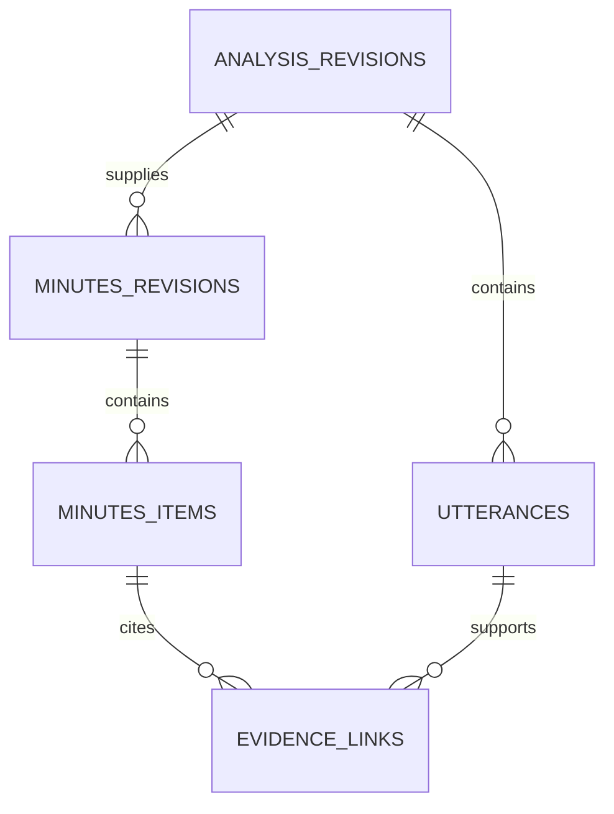

# ローカル会議録音・文字起こし・議事録作成アプリ 初期仕様書

- バージョン：v0.8
- 作成日：2026年10月1日
- 更新日：2026年10月2日
- 状態：ユーザー選択を反映した初期版要件。詳細設計・実機検証は未実施
- 基盤：Rust＋Tauri

## この仕様書の読み方

2026年10月12日のユーザー指定により、議事録の要件は [Markdownプレビューとテキスト編集の簡素化仕様](minutes-simplification.md) を優先する。本書の議事録リッチテキスト正本・根拠の発言・候補採用・直前版復元・再生成時の旧版保持は変更前の設計であり、新しい実装・完了条件には適用しない。文字起こしの版管理と利用者による会議バックアップは別機能として維持する。

- 要件・機能範囲：第2〜3章。
- 録音・話者分離・文字起こし・議事録：第5〜8章。
- 技術構成・データ・検証・実測で確定する事項：第9〜13章。
- **画面の実装イメージと操作仕様：第14章。** 録音準備は14.6、録音中は14.7、話者修正は14.9、議事録は14.10を参照。
- 参考資料と改訂履歴：第15〜16章。

## 1. 目的

Windows・macOS上で会議音声を録音し、話者ごとの文字起こしと議事録を作成するデスクトップアプリを開発する。初期版からWeb会議に対応する。

Google Meet・Zoom・Microsoft Teamsを初期版の必須対応対象とする。録音・解析の基本機能は会議サービスに依存させず、OSから取得したマイク音声と再生音を共通処理する。

本書は、これまでの会話で確認された要件と、実現のために提案した仕様・技術構成を整理したものである。実装や実機検証は未実施であり、性能・精度・各会議サービスの動作保証を確定したものではない。

## 2. 要件と決定状況

### 2.1 ユーザーから確認された要件

| ID | 要件 | 初期版への適用 |
|---|---|---|
| R-01 | Rust＋Tauriを利用する | 必須 |
| R-02 | Windows・macOSに対応する | 必須 |
| R-03 | Windows 11 24H2以降・macOS 15以降に対応する | 確定 |
| R-04 | ローカルで会議を録音する | 必須 |
| R-05 | 録音した会議を文字起こしする | 必須 |
| R-06 | 文字起こしから議事録を作成する | 必須 |
| R-07 | Web会議に初期版から対応する | 必須 |
| R-08 | 話者分離に対応する | 初期版の必須機能 |
| R-09 | Google Meet・Zoom・Microsoft Teamsの3サービスに対応する | 初期版の必須対応対象 |
| R-10 | 基本機能を会議アプリに依存させない | 必須。OSの音声取得を基盤とする |
| R-11 | モダンで直感的なUI／UXとし、実装可能な粒度で仕様化する | 必須。具体的な画面・操作案は第14章 |
| R-12 | 全体録音とアプリ選択録音を搭載する | 初期版の必須機能 |
| R-13 | スピーカー利用時のエコー・重複音声対策に対応する | 初期版の必須受け入れ条件 |
| R-14 | 話者数の自動推定、人数指定での再解析、重複区間表示に対応する | 初期版の必須機能 |
| R-15 | リッチテキストで議事録を編集できる | 初期版の必須機能 |
| R-16 | ライト・ダークテーマとOS設定への追従に対応する | 初期版の必須機能 |
| R-17 | 自動保存し、再解析・再生成時の編集保護と直前確定版の復元に対応する | 初期版の必須機能 |
| R-18 | 確認はモーダル、通知はトースト、説明は見出し横infoアイコンのポップアップに統一する | UI全体の必須ルール |
| R-19 | 取り戻せない操作は実行前に必ず確認モーダルを出す | 新規機能も含めて必須 |
| R-20 | 録音中にメイン画面が非アクティブなら小さな最前面ミニパネルを表示し、状態確認・停止・メイン画面への移動を可能にする。停止時に閉じる | 初期版の必須機能 |
| R-21 | アプリが扱うデータの関連・定義・保存・更新・削除・回復を設計する | 第10章に具体化 |

### 2.2 選択により確定した初期版の方針

2026年10月1日に、未確定事項について18問の選択式確認を実施し、以下の方針をユーザーが選択した。具体的なモデル名・性能値は、選択された評価方針に従い実測で確定する。

| 項目 | 確定した方針 |
|---|---|
| 対応OS | Windows 11 24H2以降、macOS 15以降 |
| CPU | Windows x64、Apple Silicon。Windows Arm64・Intel Macは初期必須対象外 |
| 必須会議構成 | Meet：Chrome・Edge。Zoom・Teams：デスクトップ版。両OSで検証 |
| 録音モード | 標準のマイク＋PC音声に加え、アプリ／プロセス群の選択録音を搭載 |
| スピーカー利用 | ヘッドセットだけでなくスピーカー利用も必須。エコー・重複音声対策を検証 |
| 話者分離 | 自動人数推定＋人数指定の再解析＋重複区間表示。音源分離は初期必須対象外 |
| AIエンジン | whisper.cpp＋sherpa-onnx＋llama.cppのネイティブ構成 |
| 性能検証基準 | メモリ16GBの対象Windows PC・Apple Silicon Mac。独立GPUを必須にしない |
| モデル選定 | 標準／高精度の2段階。日本語会議の実測でモデル構成を選定 |
| 保存 | 音声FLAC、会議情報SQLite。保存先変更に対応し、保護はOSのアクセス制御を基本とする |
| モデル準備 | 初回ダウンロード＋手動取り込み。準備後のAI処理はオフラインで実行可能 |
| 配布・更新 | 署名済みWindowsインストーラー・macOS DMG。初期版は手動更新 |
| 議事録形式 | 標準テンプレート1種類＋生成後の自由編集 |
| 出力 | Markdownのみ |
| 議事録編集 | リッチテキスト。見出し・箇条書き・表を直接操作 |
| テーマ | ライト・ダーク両対応＋OS設定への追従 |
| 保存・復元 | 自動保存＋直前の確定版へ復元。再解析・再生成で既存の手動編集を保護 |
| 品質目標 | 日本語会議・重複発話・スピーカー利用を実測し、標準／高精度の合格値を決定 |
| 確認・通知・説明 | 確認モーダル／トースト通知／見出し横infoポップアップに統一 |
| 取り戻せない操作 | 実行前の確認モーダルを必須とする。データ消失と復元範囲を明示 |
| 録音中の常時表示 | 他アプリの操作中も見える最前面ミニパネル。状態・時間・停止・メイン画面を開く操作を搭載 |

### 2.3 実装前の追加確認で確定した18項目

2026年10月2日、利用条件・開発目標・異常時の動作・追加機能について、一問ずつ選択式で確認した。第2.2節の既存決定は維持し、以下を追加する。「必須検証範囲」「機能要件」「開発目標」を区別する。開発目標は実装前の目標であり、実測済みの保証値ではない。

| 質問 | 選択 | 項目 | 決定内容・区分 |
|---|---|---|---|
| Q01 | B | 連続録音時間 | 4時間までを必須検証対象にする。4時間で自動停止する仕様ではない |
| Q02 | B | 話者人数 | 実際の発言者10人までを話者分離の必須検証対象にする。参加者総数ではない |
| Q03 | A | 言語 | 日本語中心。英語の製品名・専門用語が混ざる会議も検証する |
| Q04 | A | 翻訳 | 初期版に含めない |
| Q05 | B | 文字起こし・話者分離の待ち時間 | 標準プロファイルで60分の音声を30分以内に処理する開発目標 |
| Q06 | B | 議事録生成の待ち時間 | 文字起こし済みの60分の会議を5分以内に処理する開発目標 |
| Q07 | B | 録音とAI処理 | 新しい録音を優先。実行中の解析を安全な区切りで一時停止し、録音終了後に再開する |
| Q08 | B | 機器切断 | 取得できる音声を継続。欠損区間を記録・通知し、同じ機器が戻れば取得を再開。別のマイクに自動切り替えない |
| Q09 | B | 異常終了時の録音末尾損失 | 5秒以内を開発目標とする。保存済み部分の回復と併せて実機検証する |
| Q10 | A | 保存期間 | 手動削除まで保持。自動削除・期限通知は初期版に含めない |
| Q11 | B | バックアップ | 会議データ・録音・編集内容を含む手動バックアップ・復元を初期版に搭載。AIモデルは含めない |
| Q12 | B | 音声取り込み | WAV・MP3・M4A・FLACに対応。取り込みも4時間・発言者10人までを必須検証対象とする |
| Q13 | C | 用語登録 | 共通リスト＋会議ごとのリスト。文字起こしの認識を補助するヒントとして使う |
| Q14 | B | 録音中のメイン画面を閉じる | メイン画面だけ閉じ、録音・ミニパネルを継続。明示的なアプリ終了には録音終了確認を表示 |
| Q15 | A | 自動スリープ | 録音中だけ抑止し、録音終了後に解除。画面消灯は許可。明示的なスリープ・蓋閉じまで防ぐ保証はしない |
| Q16 | B | バックアップ復元時の既存データ | 既存データを残して追加。同じ会議も別会議として取り込む。置き換え復元は初期版に含めない |
| Q17 | B | 議事録の品質優先順位 | 決定事項・ToDoの正確さを優先。決定・担当者・期限を根拠と照合し、不明な情報は補完せず「未確認」と表示 |
| Q18 | B | 公開前の試用 | Windows・macOSを使う少人数の協力者に配布し、実際の会議で品質・安定性を確認する |

性能目標Q05・Q06は、メモリ16GB・独立GPU必須なしの対象Windows PCとApple Silicon Macで評価する。CPU型番・モデル・電源設定等は検証時に固定して記録する。高精度プロファイルや4時間会議へ、60分の目標値をそのまま保証として適用しない。品質と性能を同時に評価し、未達の場合は結果・代替案・影響を示して再確認する。

ここで定めた対応範囲は開発・検証の要件であり、実装済み・動作確認済みの宣言ではない。16GBは性能検証の基準であり、CPU型番や処理時間まで保証するものではない。

## 3. 初期版の機能範囲

| 分類 | 機能 | 方針 |
|---|---|---|
| 録音 | マイク音声の録音 | 対応 |
| 録音 | Web会議アプリの再生音の録音 | 対応 |
| 録音 | 会議サービスの指定なしでマイク＋システム音声を録音 | 標準方式の提案 |
| 録音 | 選択したアプリ／プロセス群だけの音声取得 | 初期版で対応 |
| 録音 | スピーカー利用時のエコー・二重発言対策 | 初期版で対応・実機検証必須 |
| 録音 | マイクと再生音の別トラック保存 | 対応 |
| 録音 | 録音前テスト、録音中の入力レベル表示 | 対応 |
| 録音 | 最前面ミニパネルからの状態確認と停止 | 初期版で対応 |
| 録音 | デバイス変更・切断の検知 | 対応 |
| 録音 | 逐次保存、異常終了後の保存済み音声の回復 | 対応 |
| 文字起こし | 日本語の時刻付き文字起こし | 対応 |
| 話者分離 | 発言区間ごとの話者ラベル付与、人数指定、重複区間表示 | 初期版で対応 |
| 編集 | 話者の名前設定、話者変更、ラベル統合 | 対応 |
| 編集 | 文字起こしの修正、該当音声の再生 | 対応 |
| 議事録 | 要約、決定事項、課題、ToDoの抽出 | 対応 |
| 議事録 | 修正済みの文字起こし・話者情報から再生成 | 対応 |
| 保存・出力 | 会議一覧、ローカル保存、Markdown出力 | 対応 |
| 取り込み | WAV・MP3・M4A・FLACの音声から解析・議事録作成 | 初期版で対応 |
| 文字起こし | 共通＋会議別の用語登録 | 初期版で対応 |
| 保存・復元 | 会議・音声・編集内容の手動バックアップ、追加復元 | 初期版で対応。モデルは除外 |
| 録音 | メイン画面を閉じても継続、自動スリープの抑止、機器再接続 | 初期版で対応 |
| 処理制御 | 録音開始時のAI処理一時停止・録音終了後の再開 | 初期版で対応 |
| UI／UX | 自動保存、直前版復元、二系統入力の状態表示、ライト・ダーク、リッチテキスト編集 | 初期版で対応。操作詳細は第14章 |

リアルタイム文字起こし、会議中のリアルタイム話者分離、声からの氏名自動特定、同時発話の音源分離、クラウド同期は、初期版の必須機能としては扱わない。必要性は別途決定する。

翻訳、動画からの音声抽出、自動削除・期限通知、定期バックアップ、既存データを置き換えるバックアップ復元、一般向けベータ公開は、今回の初期版必須範囲に含めない。

## 4. 利用の流れ

1. 会議を新規作成する。日時から仮タイトルを設定し、必要に応じて変更する。
2. 使用するマイクとシステム音声の取得範囲を確認する。標準モードでは会議サービスの指定を必須にしない。選択録音モードでは、対象アプリまたはブラウザを選択できる。
3. 初回利用時は、OSが要求する録音権限を許可する。
4. 自分側・相手側の音声が取得できることを、入力レベルと録音テストで確認する。
5. 録音を開始し、会議終了後に停止する。
6. ローカルで文字起こし・話者分離を実行する。
7. 発言内容と話者ラベルを確認し、名前設定や誤判定の修正を行う。
8. 議事録を生成・確認・編集する。
9. ローカルに保存し、必要に応じてMarkdownを出力する。

第14章のUI案では、録音保存後に文字起こし・話者分離を自動開始する。解析結果の確認画面から「議事録を作成」を押して生成へ進む。修正後の再生成は既存の編集内容を維持した新しい版として扱う。

## 5. 録音仕様

### 5.1 録音する音声

| トラック | 内容 | 主な用途 |
|---|---|---|
| マイク側 | 自分のマイクに入力された音声 | 自分の発言、同じ会議室の参加者の発言 |
| 再生音側 | システム音声、または選択したアプリ／ブラウザの再生音 | 遠隔参加者の発言、共有コンテンツの音声 |

二つのトラックは会議共通の時間軸で管理する。サンプルレートや機器のクロック差を考慮し、必要に応じてリサンプリング・時刻補正を行う。

別トラック保存は、自分側と相手側の区別、再処理、音声確認に利用する。音声を混合する場合も元のトラックを保持する。

以降の「相手側」は、この再生音側のトラックを指す。システム音声には会議以外の音も含まれ得るため、遠隔参加者の発言だけが記録されるとは限らない。

### 5.2 OS別の録音方式

| OS | マイク取得 | 標準モードの再生音取得 | 選択録音モード |
|---|---|---|---|
| Windows | WASAPIまたはcpal等 | WASAPIの出力デバイス・ループバック | Application Loopbackで対象プロセスとその子プロセスを取得 |
| macOS | Core Audioまたはcpal等 | Core Audio Tapsのグローバル取得 | 対象プロセスまたはプロセス群を指定した取得 |

macOSは音声中心の用途であるため、Core Audio Tapsを基本方式とする。ScreenCaptureKitも代替候補として評価できるが、両方式の実装を初期版に必須とはしない。

Web会議サービスの録音APIに依存せず、利用端末上の音声を取得する構成を基本とする。標準モードでは、Meet・Zoom・Teamsを判別しなくても録音を開始できる。Windowsの通常のループバックは出力デバイス単位であるため、会議アプリが実際に使っている出力先を確認する。macOSの取得範囲や、デバイス変更時の挙動も実機で確認する。

選択録音モードは、OSが公開するアプリ／プロセス情報を使う共通機能として設計する。Meet・Zoom・Teamsごとの固定プロセス名を、基本録音の成立条件にしない。必要なサービス固有の補助処理は共通録音処理から分離する。

### 5.3 会議アプリに依存しない設計と必須対応範囲

| 項目 | 方針 |
|---|---|
| 必須対応サービス | Google Meet、Zoom、Microsoft Teams |
| 標準方式 | マイク＋OSから取得した再生音を記録する |
| サービス固有の連携 | API、SDK、ブラウザ拡張、会議ボット、会議サービスへのアプリ認証を基本機能の前提にしない |
| 解析 | 音声トラックと時刻情報を入力とし、会議サービスに関係なく文字起こし・話者分離・議事録生成を実行する |
| 参加者情報 | 音声取得だけでは会議サービスの参加者名・参加者IDを取得したことにならない。名前設定は手動を基本とする |
| その他の会議サービス | OSから音声を取得できる場合に共通方式で利用できる設計を目指す。未検証のサービスの動作保証とは区別する |

初期版の受け入れ対象は、Windows・macOSの双方でMeet・Zoom・Teamsの3サービスとする。MeetはChrome・Edge、Zoom・Teamsはデスクトップ版で検証する。Zoom・TeamsのWeb版とSafariは初期必須保証に含めず、共通方式で利用できる場合も未検証の組み合わせは保証対象と区別する。

標準モードでは、通知音、音楽、別タブの動画なども録音範囲に入り得る。録音設定画面に実際の取得範囲を表示し、選択録音モードでユーザーが範囲を絞れるようにする。

### 5.4 ブラウザ会議

標準モードではブラウザの音声をシステム音声の一部として取得する。選択録音モードでも、ブラウザ単位の取得を基本とし、特定タブだけの録音は保証しない。複数タブで音声処理プロセスが共有される場合があるため、他のタブの音声が混入する可能性を検証する。

Google Meetは必須の検証対象とする。会議専用ブラウザを使用する運用も確認する。対象ブラウザはChrome・Edgeとし、検証開始時の安定版の具体的なバージョンを試験記録に残す。

### 5.5 安定性と入力確認

- 自分側・相手側を別々の入力レベルで表示する。
- 権限不足、録音開始失敗、機器切断など、検知できる異常を画面に表示する。
- 無音だけで権限拒否と断定しない。会議側が発話していない可能性も考慮する。
- Bluetooth・USB機器の接続変更、既定デバイス変更時の挙動を検証する。
- 音声を逐次保存し、異常終了後に保存済み部分を回復できる設計にする。回復可能な範囲は保存方式の決定後に定義する。

スピーカー再生では、相手の声がマイク側にも入り、発言が二重に記録される場合がある。ヘッドセットとPCスピーカーの両方を初期版の必須検証対象とする。再生音を参照信号にしたエコーキャンセル、時刻・遅延補正、または同等の対策を評価し、二重発言を抑える。実際の別参加者による同時発話を誤って消さないことも確認する。会議アプリ側のエコー対策が、本アプリの録音トラックにも適用されるとは仮定しない。

### 5.6 連続録音・機器切断・画面終了・スリープ

- 連続4時間の録音を必須検証する。マイク・PC音声の同期、音声ファイルの確定、欠損検知、停止後の解析まで確認する。4時間で強制停止しない。
- 入力機器が切断された場合、その入力の状態を「切断」とし、取得できるもう一方の音声は継続する。両方取得できない間も正常録音と誤表示せず、録音時間と欠損区間を保持する。
- 同じ機器が利用可能に戻れば取得を再開する。機器の識別・再取得可否は両OSで検証し、同一機器を確認できない場合は選択を求める。別のマイクへの自動切り替えは行わない。
- 切断・復帰はトーストで通知し、未解決状態は録音画面・ミニパネルにも残す。欠損を無音として埋めて正常な録音と扱わない。
- 録音中にメイン画面の閉じる操作をしても、アプリの録音処理と最前面ミニパネルは終了しない。ミニパネルから録音停止・メイン画面再表示を行える。
- 明示的な「アプリを終了」では確認モーダルを出す。録音停止・保存の完了を確認してから終了する。保存失敗を成功と扱って終了しない。
- 録音開始時に自動スリープの抑止を取得し、録音終了時・開始失敗時・異常処理の終了時に解除する。画面消灯は許可する。利用者の明示的なスリープ・蓋閉じ・OSの強制中断により録音が中断した場合、復帰後に欠損と回復状態を表示する。
- 異常終了時の末尾損失5秒以内を開発目標とする。音声チャンクの確定・ファイル永続化・DB登録の時間を測定する。アプリ強制終了と電源断を区別して検証し、達成を確認する前に保証値とは表示しない。

## 6. 話者分離仕様

実際に発言する10人までを必須検証範囲とする。人数の受け付け上限と検証済み範囲を混同せず、短い発言・重複発話を含めて評価する。

### 6.1 機能の定義

話者分離（Speaker Diarization）は、音声から「どの話者が、いつ話したか」を推定する機能とする。

| 機能 | 意味 | 初期版での扱い |
|---|---|---|
| 話者分離 | 発言区間に話者A・話者B等を付ける | 対応 |
| 話者の氏名設定 | 話者Aを実際の参加者名に変更する | 手動設定 |
| 声による人物の推定 | 登録済みの声から人物名を推定する | macOS先行。評価未完了モデルは候補表示 |
| 同時発話の音源分離 | 重なった声を個別音声に分ける | 別途検討 |

初期ラベルは会議内で管理する。異なる会議間で「話者A」が同じ人物を意味するとは扱わない。会議をまたぐ声の登録は独立した人物台帳で管理し、会議内の話者と関連付ける。話者ラベルや発言区間は照合によって自動統合しない。

### 6.2 トラック別の扱い

- 一人がマイクを使う通常のWeb会議では、マイク側を「自分」として扱える。
- 同じマイクを複数人が使う場合は、マイク側にも話者分離を適用する。
- 相手側のトラックに話者分離を適用し、遠隔参加者の発言を区分する。
- 自分の声が相手側にも含まれるなど、トラック間で同一人物が重複する場合は、修正可能なデータ構造にする。スピーカー利用時の回り込み・二重発言対策を初期版の必須条件に含め、具体的な照合方法は録音検証で決める。

### 6.3 採用するエンジンとモデル評価

| エンジン | 構成 | 位置づけ |
|---|---|---|
| sherpa-onnx | 発話区間推定モデル＋話者埋め込みモデル＋クラスタリング。Rust APIの公式サンプルあり | 初期版の採用エンジン |
| pyannote.audio＋Community-1 | Pythonベースの話者分離パイプライン | 参考比較に利用可能。初期版の配布構成には含めない |

公式サンプルの存在は、対象端末での配布・性能・日本語精度の確認済みを意味しない。モデルの組み合わせ、人数推定方法、処理時間を実機評価して決める。通常は人数を自動推定し、利用者が人数を指定して同じ保存音声を再解析できるようにする。人数指定は会議全体または解析対象トラックへの適用を明示する。重複区間の情報を保持・表示し、音源分離による個別音声への復元は必須にしない。

### 6.4 表示・修正

- 発言ごとに話者ラベル、開始・終了時刻、発言内容を表示する。
- ユーザーが話者名を設定できる。
- 発言単位で話者を変更できる。
- 話者のチェック操作はモーダル内に保持し、「保存」を押したときだけ反映する。閉じる・Escでは未保存の選択を取り消す。保存失敗時は選択を保持して再試行できる。
- 発言一覧はページで区切らず、検索・話者絞り込みに一致する全発言を順序通りに表示する。
- 同じ話者・同じトラックで間隔2秒以内の連続発言は、60秒・本文20,000文字を上限に1件の発言として保存する。表示・編集・話者変更・再生・検索も統合後の1件を使い、「区間を表示／区間をまとめる」は設けない。統合前の解析版と下書き履歴を保持して新しい現在版へ切り替える。話者不明、発言重複、音声欠損、手動で分割した部分は自動統合しない。未保存の編集や声の処理中は統合を開始しない。
- 同一人物が複数ラベルに分かれた場合、ラベルを統合できる。
- 話者一覧の「話者を統合」で統合元・統合先と対象発言数を確認し、確定時に保存する。登録済みの声の特徴量は統合しない。
- 発言の三点メニューから「発言を手動分割」を開き、音声を確認しながら時刻・本文の切れ目・前後の話者を指定して保存する。本文の連結と元の時間範囲を保持する。
- 「発言一覧」の見出し右側に「再生位置へ移動」を置く。利用者の押下時だけ現在位置へスクロールし、必要なら検索・話者絞り込みを解除して該当発言を表示する。再生・一時停止中の位置に対応し、編集内容を自動保存しない。
- 誤って同じラベルにまとめられた発言は、新しい話者に割り当てられる。
- 判定困難な区間を「話者不明」、発言が重なる区間を「発言重複」として保持・表示できる設計にする。重複区間の自動検出と表示を必須にし、検出手法・合格値はモデル評価で決める。
- 元の推定結果と手動修正結果を区別し、再処理時に修正が無条件に失われないようにする。

短い相づち、似た声、通信音声の劣化、同時発話による誤判定を想定する。完全な話者識別や、重なった発言の完全な復元は保証しない。

## 7. 文字起こし仕様

文字起こしエンジンはwhisper.cppを採用し、日本語対応の多言語モデルを使用する。モデルサイズと量子化方式は、対象PCの性能・認識精度を評価して決める。

- 発言に開始・終了時刻を付ける。
- 音声認識結果と話者分離結果を、共通の時間軸で照合する。
- 話者が切り替わる箇所を含む発言区間は、必要に応じて区切り直す。
- 発言から該当音声を再生できるようにする。
- 元の認識結果とユーザー修正後のテキストを区別して保持する。

Whisperによる文字起こしだけで、話者分離や正確な単語単位の時刻対応がすべて解決するとは扱わない。必要な時刻精度と整列方法は検証で決める。

### 7.1 対応言語・用語登録

初期版の必須対象は日本語中心の会議とし、英語の製品名・人名・専門用語が含まれるケースを検証する。英語のみの会議・日英の継続的な切り替え・翻訳は必須対象にしない。

共通用語と会議別用語を登録し、解析開始時に合わせた用語ヒントを固定する。会議別の内容を優先し、同じ用語は重複排除する。用語文字列・読み・補足を保存可能な設計とするが、エンジンへ渡す方式は実測で決める。用語を事後の無条件な置換辞書として扱わない。登録による改善は評価し、必ず正しく認識されるとは表示しない。

登録を変更しても既存の文字起こしを勝手に書き換えない。再解析は新しい候補を作成し、既存の手動編集を保持する。ヒントの容量上限・採用順を検証して定め、上限を超えて未使用になった登録を利用者が確認できるようにする。

### 7.2 外部音声の取り込み

- WAV・MP3・M4A・FLACをファイル選択またはドラッグ＆ドロップで取り込む。4時間・発言者10人までを必須検証する。
- 拡張子だけで判定せず、内容・デコード可否・長さ・容量を確認する。M4A等のコンテナ内の対応コーデックは実装時に検証・明記する。
- 取り込み元のファイルは変更・移動・削除しない。アプリ管理領域に原本をコピーし、解析用音声を作成する。正常終了後は元ファイルの場所に依存せず再解析できる。
- 外部音声ではマイク・PC音声の二系統があると仮定しない。単一・ステレオ音声から話者分離し、チャネルだけで「自分」を決めない。
- 途中失敗・キャンセル時には未確定の取り込み物だけを整理し、既存会議や元ファイルを削除しない。解析未準備の場合も取り込みを保存し、後から解析できる。
- 音声取り込みで作られた会議を録音会議と同じ一覧・編集・生成導線で扱う。MP4等の動画からの音声抽出は初期版に含めない。

## 8. 議事録生成仕様

llama.cppを採用し、日本語対応LLMをローカルで実行する。標準／高精度の2段階を用意し、具体的なモデル名・量子化方式は16GBの検証端末と日本語会議での実測により選定する。独立GPUを必須にしない。

### 8.1 出力項目案

| 項目 | 内容 |
|---|---|
| 会議情報 | タイトル、日時、確認された参加者名 |
| 概要 | 会議全体の要約 |
| 議題・論点 | 主な議題と議論内容 |
| 決定事項 | 会議で明示的に決まった内容 |
| 課題・未決事項 | 残っている課題、確認事項 |
| ToDo | 作業内容、明示された担当者・期限 |
| 根拠 | 元発言の時刻・発言ID |

### 8.2 生成方針

品質評価では決定事項・ToDoの正確さを最優先する。要約の流暢さだけで合格とせず、決定・担当者・期限と根拠の対応、重要項目の欠落、発言にない情報の追加を個別に確認する。

- ユーザー修正後の文字起こし・話者情報を生成入力に優先する。
- 発言者とタスク担当者は別に扱い、発言者を自動的に担当者にしない。
- 担当者・期限が明示されていない場合は「未確認」とする。
- 提案や検討中の内容を、確定した決定事項として扱わないようにする。
- 元発言へ移動できる根拠参照を付け、参照先が実在することを検証する。
- 生成結果をユーザーが編集できるようにする。
- 長時間会議は、文字起こしを分割して情報を抽出し、全体を統合する方式を候補とする。分割時に話者・発言ID・時刻を引き継ぐ。

生成結果の正確性はモデル評価とユーザー確認に依存する。テンプレートは本章の会議情報・概要・議題・決定事項・課題／未決事項・ToDo・根拠を持つ標準1種類とし、生成後に自由編集できる。用途別・ユーザー定義テンプレートは初期必須にしない。

## 9. 技術構成案

| 層 | 採用技術・詳細設計の基盤 | 責務 |
|---|---|---|
| UI | Tauri 2＋React／TypeScript | 録音、履歴、話者編集、リッチテキスト議事録編集、ライト・ダーク |
| アプリ制御 | Rust | 状態管理、音声処理の制御、保存、処理ジョブ |
| OS固有録音 | WASAPI／Core Audio Taps、マイク入力API | 会議サービスに依存しない音声取得、取得範囲とデバイスの操作 |
| 文字起こし | whisper.cpp | 音声認識 |
| 話者分離 | sherpa-onnx | 発言区間と話者の推定、人数指定、重複区間の保持 |
| 議事録生成 | llama.cpp＋日本語対応LLM | 構造化情報の抽出と要約 |
| データ保存 | SQLite＋音声ファイル | 会議、発言、話者、処理状態の永続化 |

Rustを中心に制御し、必要なネイティブAPIやC/C++エンジンを利用する。全コンポーネントをRustだけで実装することは要件にしない。

推論エンジンの接続はFFIまたはTauriのサイドカーを候補とする。OS固有コードと共通処理を分離し、AI処理中も録音画面・編集画面を操作できる構成にする。

共通録音層は、入力デバイス、システム音声／プロセス群の取得範囲、音声データ、時刻、状態イベントを扱う。会議サービス名は、音声認識・話者分離・議事録生成の必須入力にしない。サービス固有の補助機能を追加する場合も、この共通処理を置き換えない構成にする。

## 10. ローカル保存・処理状態

### 10.1 保持する主要情報

| データ | 主な項目 |
|---|---|
| 会議 | ID、タイトル、日時、録音対象、処理状態 |
| 音声トラック | ID、会議ID、入力種別、ファイル、時間情報 |
| 発言 | ID、トラックID、開始・終了時刻、話者ID、原文、修正テキスト |
| 話者 | 会議内ID、推定ラベル、表示名 |
| 議事録 | 生成内容、編集内容、参照発言ID、生成日時 |
| 処理ジョブ | 処理種別、状態、使用モデル、失敗情報 |

詳細なエンティティ・列・関連・保存ルールは第10.4〜10.16節で定義する。話者区間と文字起こしを別エンティティとして管理し、重複発話と固定した根拠参照を表現する。

### 10.2 音声形式・保存場所・保護

確定した音声はFLACで保存し、会議情報・発言・議事録・版情報はSQLiteで保持する。推論エンジンへ渡す際は必要なPCM形式に変換する。録音中は独立した音声セグメントを逐次確定し、最終変換が完了するまで回復に必要な原音声を保持する。セグメント長と一時ファイル形式は録音性能・回復試験で決める。

既定の会議保存先を用意し、設定からユーザーが変更できる。保存先変更は録音・解析・生成が実行中の場合は開始させない。既存データを含む移動はコピー・整合性確認後に切り替え、途中失敗時は旧保存先を維持する。AIモデルの配置先と会議データの保存先は区別して表示する。

保護はOSのアクセス制御を基本とし、アプリ独自の暗号化・鍵管理は初期必須に含めない。音声・文字起こし・議事録の削除範囲をUIで明示する。自動で録音を削除する保持期限は設けず、利用者による削除を基本とする。

### 10.3 状態と再処理

録音中、録音保存済み、解析中、解析完了、議事録生成中、完了、失敗の状態を区別する。文字起こし・話者分離・議事録生成の処理状態を個別に保持し、録音し直さずに失敗した段階を再実行できる設計にする。

### 10.4 データ設計の原則と型

本節以降は初期版の論理データ設計とする。テーブル名・主キー・外部キー・主要列・整合性ルールを定義し、物理DDLとマイグレーションはこの設計から実装する。

| 項目 | 設計ルール |
|---|---|
| エンティティID | UUIDの文字列表現をTEXTで保持。会議名やファイル名を識別子にしない |
| 日時 | UTCのUnix時刻ミリ秒をINTEGERで保存。画面で利用端末のタイムゾーンへ変換 |
| 音声上の時刻 | 録音会議は録音開始、取り込み会議は音声先頭を0とするマイクロ秒をINTEGERで保存。開始を含み終了を含まない区間とし、0≦start_us＜end_us |
| 音声フレーム | フレーム位置・サンプルレート・チャンネル数を別々に保持。ステレオのサンプル数とフレーム数を混同しない |
| 真偽値 | INTEGERの0／1。必要なCHECKを定義する |
| JSON | TEXTとして保持し、schema_versionとRust側の型付き検証を必須にする。通常の関連は外部キーで表す |
| 任意値 | 不明はNULL。担当者未確認、話者不明を架空の文字列IDで埋めない |
| ハッシュ | SHA-256等の固定した方式で完全性と入力版を識別する。方式も記録する |
| 編集競合 | 下書き・会議の操作対象にlock_versionを付け、期待版が一致する場合だけ更新する |
| スキーマ変更 | schema_migrationsで適用順・チェックサム・適用日時を保持する |

revision_noは会議ごとの増加カウンターから発行し、整理した版の番号を再利用しない。採番と会議のカウンター更新を同じトランザクションで行う。

音声の時刻は録音の単調時計を基準にする。PCの壁時計が会議中に変更されても発言順や再生位置を変えない。UTC開始日時と録音内の相対時刻を分ける。

### 10.5 エンティティと関連

| 分類 | エンティティ | 関連と役割 |
|---|---|---|
| 会議 | meetings | 録音、解析版、議事録版、下書き、ジョブの親 |
| 録音 | recording_sessions | 録音由来の会議につき一つの録音セッション。取り込み会議には作成しない |
| 音声 | audio_tracks／audio_chunks | 録音セッションまたは取り込みに複数トラック、トラックに複数セグメント |
| 音声整合 | track_clock_segments／audio_gaps／track_inputs | 時刻対応、欠損区間、加工トラックの入力関係 |
| ファイル | file_assets | 音声・一時ファイルの場所、ハッシュ、確定状態 |
| 解析 | analysis_revisions | 音声・解析設定に対応する、公開後は変更しない解析結果の版 |
| 話者 | speakers／speaker_segments | 解析版内の話者と、その発言区間 |
| 発言 | utterances／utterance_speakers | 解析版内の文字起こしと複数話者の割り当て |
| 議事録 | minutes_revisions／minutes_items | 入力解析版と結び付いた文書版、決定事項・ToDo等の構造化項目 |
| 根拠 | evidence_links | 議事録項目から、特定の解析版の発言への参照 |
| 編集 | working_drafts／edit_operations | 自動保存する作業中の編集、取り消し用の操作情報 |
| 処理 | processing_jobs | 段階ごとの処理状態、固定された入力版、モデル、再試行情報 |
| AI | model_packages／model_files | モデルと関連ファイル、バージョン、完全性、準備状態 |
| AI設定 | model_profiles／profile_components | 標準／高精度と、各処理に使うモデル構成 |
| アプリ設定 | app_settings | テーマ、機器選択、パネル位置等 |
| 出力 | export_records | 書き出した版、保存先、時刻、結果 |
| 保守 | maintenance_operations／schema_migrations | 削除・移動・整理・バックアップ・追加復元の再開情報、DB変更の適用記録 |
| 用語 | vocabulary_entries／vocabulary_snapshots | 共通・会議別用語と、解析時に固定した入力ヒント |
| 取り込み | audio_imports | 外部音声の管理コピー・変換・状態。会議につき一つの取り込み |

議事録の根拠関係は以下のとおりとする。単に現在の発言テキストを参照するのではなく、解析版を含めて固定する。

### 10.6 会議・録音・ファイルの定義

以下の型はSQLiteの格納型を示す。PKは主キー、FKは外部キーとする。更新可能なレコードはcreated_at／updated_at、確定版はcreated_atを共通列として持つ。

| テーブル | キー | 主要列と型 | 制約・用途 |
|---|---|---|---|
| meetings | id TEXT PK | title TEXT、started_at_utc_ms INTEGER NULL、duration_us INTEGER、lifecycle TEXT、current_analysis_id TEXT NULL FK、previous_analysis_id TEXT NULL FK、current_minutes_id TEXT NULL FK、previous_minutes_id TEXT NULL FK、next_analysis_no INTEGER、next_minutes_no INTEGER、lock_version INTEGER | 版の参照は同じ会議に限定。状態を失敗一つで全体に上書きしない |
| recording_sessions | id TEXT PK、meeting_id TEXT FK UNIQUE | state TEXT、capture_mode TEXT、capture_config_json TEXT、start_operation_id TEXT UNIQUE、stop_operation_id TEXT NULL UNIQUE、started_at_utc_ms INTEGER NULL、ended_at_utc_ms INTEGER NULL、duration_us INTEGER、audio_manifest_hash TEXT NULL、last_committed_us INTEGER | capture_modeはsystem／application。機器・選択アプリの情報は設定スナップショットとして保持 |
| audio_tracks | id TEXT PK、meeting_id TEXT FK、session_id TEXT NULL FK、import_id TEXT NULL FK | kind TEXT、format TEXT、sample_rate INTEGER、channels INTEGER、state TEXT、device_label TEXT NULL、processing_config_json TEXT NULL | kindはmic／system／imported／processed。session_idとimport_idはいずれか一つを必須とし、同じ会議への参照を検証。加工トラックも元の取得経路を保持。機器交換時の実形式はセグメントと時計区間にも記録 |
| file_assets | id TEXT PK、meeting_id TEXT NULL FK | storage_scope TEXT、relative_path TEXT、media_type TEXT、size_bytes INTEGER、hash_algorithm TEXT、content_hash TEXT NULL、state TEXT | storage_scope＋relative_pathを一意にする。meeting／tempの管理範囲を区別 |
| audio_chunks | id TEXT PK、track_id TEXT FK、file_asset_id TEXT FK UNIQUE | sequence INTEGER、start_us INTEGER、end_us INTEGER、frame_count INTEGER、sample_rate INTEGER、channels INTEGER、state TEXT | UNIQUE(track_id, sequence)。確定セグメントだけを解析入力へ含める |
| track_clock_segments | id TEXT PK、track_id TEXT FK、chunk_id TEXT FK | source_frame_start INTEGER、source_frame_end INTEGER、timeline_start_us INTEGER、timeline_end_us INTEGER、mapping_json TEXT | トラックのフレーム位置から会議時間への対応を保持。異なる機器の時計を同一視しない |
| audio_gaps | id TEXT PK、track_id TEXT FK | start_us INTEGER、end_us INTEGER、reason_code TEXT、recovered INTEGER | 切断・取得停止・保存失敗等。無音とは区別する |
| track_inputs | derived_track_id TEXT FK、input_track_id TEXT FK、role TEXT | PK(derived_track_id, input_track_id, role) | エコー対策の対象マイクと再生参照等を追跡。同一会議内に限定し、循環を禁止 |

recording_sessions.stateはpreparing／recording／stopping／saved／interrupted／failed、file_assets.stateはwriting／ready／missing／corrupt／delete_pending等を定義する。状態の許可遷移はRust側で管理し、画面から任意の文字列へ変更させない。

セッションの長さは会議時間軸上の長さ、取得済み音声の長さは各セグメントから算出する。機器切断がある場合に両者が異なることを保持する。欠損区間をゼロ音量の正常音声として記録しない。

機器ID・PID等はその録音時点の情報であり、再起動後の恒久的な本人・機器識別子とは扱わない。選択アプリ情報を音声認識・議事録の必須入力にしない。

### 10.7 解析版・話者・発言の定義

| テーブル | キー | 主要列と型 | 制約・用途 |
|---|---|---|---|
| analysis_revisions | id TEXT PK、meeting_id TEXT FK、parent_revision_id TEXT NULL FK | revision_no INTEGER、parent_content_hash TEXT NULL、origin TEXT、publication_state TEXT、audio_manifest_hash TEXT、profile_snapshot_json TEXT、config_json TEXT、content_hash TEXT、schema_version INTEGER | UNIQUE(meeting_id, revision_no)。originはengine／manual_snapshot。作成中と確定済みを区別 |
| speakers | id TEXT PK、analysis_revision_id TEXT FK | lineage_id TEXT、label TEXT、display_name TEXT NULL、input_scope TEXT、identification_state TEXT | UNIQUE(analysis_revision_id, lineage_id)。lineage_idは同じ会議の修正前後で対応を追うID |
| speaker_segments | id TEXT PK、analysis_revision_id TEXT FK、track_id TEXT FK、speaker_id TEXT NULL FK | start_us INTEGER、end_us INTEGER、overlap_group_id TEXT NULL、confidence REAL NULL | 同じ版のspeaker_idだけを参照。複数話者の同時区間を許す |
| utterances | id TEXT PK、analysis_revision_id TEXT FK、track_id TEXT FK | lineage_id TEXT、sequence INTEGER、start_us INTEGER、end_us INTEGER、recognized_text TEXT、effective_text TEXT、attribution_state TEXT、confidence REAL NULL | recognized_textは元の認識結果。effective_textはその確定版に採用した修正を含む |
| utterance_speakers | utterance_id TEXT FK、speaker_id TEXT FK、analysis_revision_id TEXT FK | role TEXT、assignment_source TEXT、PK(utterance_id, speaker_id) | 同時発話に備えて多対多。roleはprimary／overlap、assignment_sourceはinferred／manual等 |

発言の話者不明は割り当てなし＋attribution_state=unknownで表す。発言の話者を一つの列に固定しない。重複区間の文字起こしを二人分復元できたことにはならず、区間の検出・割り当てと音源分離を区別する。

話者・発言のIDは解析版ごとに一意とする。再解析で境界が変わる場合も、古い発言を新しい発言へ無条件に置換しない。lineage_idの引き継ぎは対応が確認できたときだけ行い、分割・統合・不明な対応は操作情報に記録する。

話者人数の指定値・適用トラック・自動推定結果・重複検出設定はanalysis_revisions.config_jsonへ保存する。推定の信頼度がエンジンから取得できない場合はNULLとし、見かけの数値を作らない。

会議をまたぐ声の登録・照合はmacOSで先行提供する。利用者が保存済み会議の話者と人物を明示的に登録した場合だけ、正規化したfloat32の特徴量を人物台帳へ永続化する。人物名、モデルSHA-256、抽出方式、次元数、登録元の会議・解析版・トラック・区間、登録日時を保持する。登録用音声の別コピーは作らず、元音声の削除後も登録した特徴量は保持する。人物や個々の声は設定およびメニューの「ボイス一覧」から削除でき、過去の会議の表示名は保持する。「ボイス一覧」は登録した人物と登録区間を表示し、保存されたサンプルIDから元の会議・トラック・区間を解決して特徴量抽出に使った音声だけを再生する。元音声が残っていない区間は再生不可と表示する。解析版が置き換わっても、元の音声と登録区間が残っていれば再生できる。

話者パネルで、他の話者と重ならず欠損を含まない単独発言から最長2区間を選び、各区間の中央最大30秒を登録する。1秒未満の区間や特徴量を取得できない音声は登録しない。登録操作は人物台帳への追加と元会議の名前・人物対応の確定を一つのトランザクションで保存する。通常の話者名変更や候補の確定から特徴量を自動追加しない。

同じモデル・抽出方式の登録特徴量だけで人物ごとの重心を作り、コサイン類似度と次点との差で照合する。評価済みの判定条件があるモデルだけ高一致を自動適用し、それ以外は候補として表示する。未校正時の候補表示の下限は類似度0.5とし、本人である確率とは表示しない。手動で付けた名前と人物対応は自動照合で上書きしない。同一トラックで同時発話する別話者を同じ人物へ自動適用しない。過去会議は利用者の照合操作で処理し、人物台帳の変更だけで一括更新しない。

人物台帳、特徴量、人物対応、判定条件をバックアップへ含める。特徴量のバイナリ列は型付きBase64として転送し、復元先では人物IDと残っている登録元の参照を再割り当てする。同名人物の自動統合はしない。モデル変更で非互換になった特徴量は利用せず、会議から追加登録する。Windowsでの登録・照合と専用の登録録音画面は後続とする。

### 10.8 議事録・構造化項目・根拠の定義

| テーブル | キー | 主要列と型 | 制約・用途 |
|---|---|---|---|
| minutes_revisions | id TEXT PK、meeting_id TEXT FK、input_analysis_id TEXT FK、parent_revision_id TEXT NULL FK | revision_no INTEGER、parent_content_hash TEXT NULL、publication_state TEXT、generated_document_json TEXT、effective_document_json TEXT、document_schema_version INTEGER、input_content_hash TEXT、content_hash TEXT、model_snapshot_json TEXT、template_version TEXT | 生成原文と採用後の文書を区別。入力版とモデルを固定 |
| minutes_items | id TEXT PK、minutes_revision_id TEXT FK | kind TEXT、order_no INTEGER、body TEXT、assignee_name TEXT NULL、assignee_speaker_id TEXT NULL FK、due_date TEXT NULL、due_text TEXT NULL、source_type TEXT | kindはsummary／topic／decision／open_issue／todo。担当者未確認はNULL |
| evidence_links | id TEXT PK、minutes_item_id TEXT FK、analysis_revision_id TEXT FK、utterance_id TEXT FK | quote_text TEXT NULL、start_us INTEGER、end_us INTEGER、source_type TEXT、verification_state TEXT | 参照発言と解析版の一致、区間内の時刻、同じ会議であることを検証 |

リッチテキストの正本はバージョン付きの文書JSONとする。見出し・段落・箇条書き・表・根拠チップを型付きノードで表し、根拠チップにminutes_item_id／evidence_link_idを持たせる。Markdownは正本から出力する派生物とし、JSONとMarkdownを独立編集する二重管理をしない。

minutes_itemsは生成項目の構造化情報と文書ノードを結ぶ。文書から項目を削除・編集した場合は、文書JSON・項目・根拠を同一更新単位で整合させる。自由入力の文に根拠がない場合は、手動追加として扱い、架空の発言参照を付けない。

担当者は会議の話者に限らないため、assignee_nameとassignee_speaker_idを分ける。発言者を自動的に担当者としない。日付として確定できる期限だけをdue_dateへYYYY-MM-DDで保持し、「来週中」等の原表現はdue_textへ残す。根拠のない日付補完はしない。

議事録の根拠はinput_analysis_idに含まれる確定発言へ固定する。その後に話者名・発言を修正しても、根拠の引用・時刻が無通知で変わらないようにする。現在の作業内容のハッシュとinput_content_hashが異なれば、UIに「元データ更新あり」を表示する。

### 10.9 下書き・自動保存・直前版復元

| テーブル | キー | 主要列と型 | 制約・用途 |
|---|---|---|---|
| working_drafts | id TEXT PK、meeting_id TEXT FK | target_kind TEXT、base_analysis_id TEXT NULL FK、base_minutes_id TEXT NULL FK、payload_json TEXT、schema_version INTEGER、content_hash TEXT、lock_version INTEGER、updated_at INTEGER | UNIQUE(meeting_id, target_kind)。transcript／minutesそれぞれ一つ。対応する基底版を一つだけ指定 |
| edit_operations | id TEXT PK、draft_id TEXT FK | sequence INTEGER、operation_kind TEXT、payload_json TEXT、inverse_json TEXT、before_hash TEXT、after_hash TEXT、created_at INTEGER | 取り消し対象の操作と逆操作。古い版の上へ誤適用しない |

作業中の変更は下書きへ自動保存する。文字起こし下書きには話者名、発言ごとのテキスト・話者割り当て等の編集内容を、議事録下書きにはリッチテキスト文書を保持する。JSON内の発言・話者・根拠IDを、基底版と照合して検証する。

確定版の本文・話者・発言・根拠は公開後に変更しない。スナップショット作成では、新しい版のID・発言ID・文書項目ID等へ対応を移し、JSON内の参照も同じ更新単位で検証する。

確定済みの解析版・議事録版を、自動保存のたびに破壊的上書きしない。生成を始めるときは、下書きを含む実際の入力を固定したスナップショットにし、そのIDとハッシュをジョブに渡す。生成中に編集が続いても、入力が途中で変わらないようにする。

| 操作 | データの扱い |
|---|---|
| 通常編集 | 下書きを更新し、lock_versionを進める。永続化完了後だけ保存済み表示 |
| 議事録生成 | 現在の文字起こし下書きを確定入力スナップショットにして使用 |
| 再解析・再生成 | 新しい候補版を作り、現在版・既存下書きを維持 |
| 候補の採用 | 確認した内容を固定し、現在版・直前版の参照と必要な下書きを一つのDBトランザクションで切り替える |
| 直前版への復元 | 現在版と直前版を基本的に入れ替えて戻せるようにする。下書きを失う場合は確認が必要 |
| 未保存・下書きの破棄 | 必ず確認モーダルで対象を示し、確定後にだけ破棄する |

利用者向けの履歴は「現在＋直前確定版」とし、全生成版の閲覧機能を追加しない。一方で現在・直前の議事録が根拠として参照する解析スナップショットは、技術的な参照先として保持する。これは無制限の公開履歴ではなく、根拠の整合性を維持するための保持である。

公開版、下書きの基底、議事録の根拠、実行中ジョブに参照される版は削除しない。参照のない古い候補・再作成可能な一時ファイルを整理できるが、確認済みの保存音声・手動編集・利用者が復元できる版を無確認で消さない。

直前版を入れ替える際に、従来の直前版が実際に復元不能になる場合は第14.18節の確認が必須である。参照関係を調べて、消失する版と残る版を確認モーダルに正確に表示する。

### 10.10 処理ジョブとモデル管理

| テーブル | キー | 主要列と型 | 制約・用途 |
|---|---|---|---|
| processing_jobs | id TEXT PK、meeting_id TEXT NULL FK、input_analysis_id TEXT NULL FK、output_analysis_id TEXT NULL FK、output_minutes_id TEXT NULL FK | kind TEXT、state TEXT、operation_id TEXT UNIQUE、retry_of_job_id TEXT NULL FK、input_manifest_hash TEXT、profile_snapshot_json TEXT、parameters_json TEXT、completed_units INTEGER NULL、total_units INTEGER NULL、error_code TEXT NULL、attempt INTEGER、started_at INTEGER NULL、finished_at INTEGER NULL | 文字起こし・話者分離・結果整理・議事録生成等を区別。入力・モデル・設定を固定 |
| model_packages | id TEXT PK | engine TEXT、model_name TEXT、model_version TEXT、quantization TEXT NULL、source_type TEXT、manifest_json TEXT、manifest_hash TEXT、license_ref TEXT NULL、state TEXT | download／manual_importを区別。名称だけで同じモデルとみなさない |
| model_files | id TEXT PK、package_id TEXT FK | relative_path TEXT、expected_size INTEGER NULL、actual_size INTEGER、expected_hash TEXT NULL、actual_hash TEXT、state TEXT | パッケージ内でrelative_pathを一意にし、パストラバーサルを拒否 |
| model_profiles | id TEXT PK | name TEXT、profile_version INTEGER、state TEXT | nameはstandard／high_accuracy。変更時に既存ジョブの設定を変えない |
| profile_components | profile_id TEXT FK、role TEXT、package_id TEXT FK | settings_json TEXT、PK(profile_id, role) | asr／segmentation／speaker_embedding／llm／必要な音声前処理等の構成 |

analysis_revisionsとminutes_revisionsのpublication_stateはbuilding／candidate／committed／internal_snapshot等を定義し、確定後の本文を変更しない。ジョブstateはqueued／running／pausing／paused／succeeded／failed／cancelled／interruptedとする。pausingは安全な区切りへの移行中、pausedはチェックポイントを確定して実行を停止した状態とし、停止理由・再開位置を保持する。成功した結果を保持して段階別に再試行できる。再試行は新しいジョブIDで元ジョブとの関連を保持し、同じ操作の二重実行はoperation_idで防ぐ。

expected_hashがあるダウンロードは実ハッシュと照合する。手動取り込みで配布元のハッシュが不明な場合も実ハッシュを計算して記録し、エンジン互換性を確認する。ただしローカルで計算したハッシュだけを、配布元の真正性を検証した証拠にはしない。

使用中・準備未完了・不適合のモデルを区別する。既存ジョブのprofile_snapshot_jsonは、構成するモデルID・ファイルハッシュ・推論設定・エンジン版を含める。モデル更新後も過去の生成条件を追えるようにする。

### 10.11 設定・書き出し・保守情報

| テーブル | キー | 主要列と型 | 制約・用途 |
|---|---|---|---|
| app_settings | key TEXT PK | value_json TEXT、schema_version INTEGER、updated_at INTEGER | テーマ、入力機器の選択条件、追従設定、文字サイズ、ミニパネル位置等 |
| export_records | id TEXT PK、meeting_id TEXT FK、minutes_revision_id TEXT NULL FK | exported_content_hash TEXT、format TEXT、destination_path TEXT、state TEXT、exported_at INTEGER NULL | Markdown出力の対象内容・結果を記録。外部ファイルをアプリの音声として管理しない |
| maintenance_operations | id TEXT PK、meeting_id TEXT NULL FK | kind TEXT、state TEXT、target_manifest_json TEXT、target_hash TEXT、consent_at INTEGER NULL、progress_json TEXT、error_code TEXT NULL | delete_meeting／delete_assets／move_storage／prune_revisions等。対象と確認内容を固定して中断後に再開 |
| schema_migrations | version INTEGER PK | checksum TEXT、applied_at INTEGER | 二重適用を防ぎ、既存データとの互換性を記録 |

録音の正準状態・録音終了の確認処理はRust側で共有する。ミニパネルの位置・テーマ等の設定と、録音中のセッション状態を混ぜない。トースト自体は一時UIとし、必要な原因・未解決状態はジョブ、欠損、保存状態等に保持する。

会議保存先を示す起動用設定は、会議データの外に小さな設定ファイルとして保持する。移動途中でも、起動時にどのDBを開くべきか分かるようにし、保存先の切り替えは検証後に更新する。

### 10.12 保存ディレクトリとファイル管理

| 保存領域 | パス例 | 内容 |
|---|---|---|
| 会議DB | 選択した保存先／meetings.sqlite3 | 会議、解析、議事録、下書き、ジョブ等 |
| 音声 | 選択した保存先／meetings／会議ID／audio／トラックID／セグメントID.flac | 確定音声。利用者の会議名を物理パスに使わない |
| 録音中ファイル | 選択した保存先／temp／録音セッションID／セグメントID.part | 書き込み途中・変換途中。確定音声と区別 |
| 推論一時データ | 選択した保存先／temp／ジョブID | PCM変換等の再作成可能なデータ |
| モデル | OSのアプリデータ領域／models／モデルパッケージID | 初回取得・手動取り込みモデル。会議保存先とは分離 |
| 起動用設定 | OSのアプリ設定領域／bootstrap.json | 保存先、移動処理の回復情報 |
| 書き出し | 利用者が保存ダイアログで指定した場所 | アプリ外へ出力したMarkdown |

file_assetsには管理ルートからの相対パスを記録する。起動設定の保存先や外部への出力先は絶対パスを使うが、SQLへ文字列連結せずパラメーターとして扱う。相対パスは正規化し、管理ルート外へ抜ける指定を拒否する。

会議DBを置く初期の保存先は、検証済みのローカルファイルシステムを対象とする。SQLiteのWALを使うDBを、未検証のネットワーク共有へ置くことはサポート範囲に含めない。保存先変更の選択時に適合性を確認する。

### 10.13 制約・索引・トランザクション

- 同じ保存先へ複数のアプリ本体が同時に録音を書き込まないよう起動時の排他を設ける。録音セッションのpreparing／recording／stoppingは全会議で一つだけとし、Rustの録音ロックとDBの部分一意制約で二重開始を防ぐ。停止要求はstop_operation_idとセッション状態で重複排除する。
- SQLiteの各接続で外部キー制約を有効にする。会議・版が一致する関連は、必要な複合UNIQUEと複合FKで検証する。IDの存在だけを確認して別会議の発言を引用させない。
- 音声区間の開始・終了、人数の正整数、ファイルサイズの非負値等にCHECKを付ける。重複発話の区間重なり自体は禁止しない。
- parent_revision_idは版の由来を追う補助参照とし、古い親版の整理ではSET NULLを許可する。由来のparent_content_hashは残す。本文・入力・根拠の参照とは区別し、親参照だけで全過去版が永久保持されないようにする。
- export_recordsの元議事録版は整理時にSET NULLを許可し、出力内容ハッシュと出力先を残す。外部ファイルが存在することを理由に、全過去議事録を保持し続けない。
- 根拠・下書き・実行中ジョブに参照される確定版の削除はRESTRICTを基本とする。親削除時のCASCADEは、明示的に削除対象に含めた所有データへ限定する。
- meetingsの日時、audio_chunksのトラック＋順序、utterancesの版＋開始時刻、speaker_segmentsの版＋開始時刻、evidence_linksの発言、processing_jobsの状態＋作成日時に索引を付ける。
- 初期の会議名・発言検索は、対象会議や版を絞ってパラメーター付き検索を行う。全文索引を必須にはしない。規模が増えた場合に日本語検索の方式を別途評価する。
- WALを使い、書き込みをRust側で直列化する。書き込みトランザクションを短くし、録音・推論・長いファイルコピーをDBトランザクション中に実行しない。
- 永続化の基準はsynchronous=FULLとし、実際の保存時間を測定する。WALのチェックポイントを管理し、DBバックアップや移動に生のDB本体だけを無条件にコピーしない。
- 解析結果の公開、候補の採用、文書＋項目＋根拠の更新は、それぞれ一つのDBトランザクションで完了させる。画面イベントはコミット後に配信する。

DBトランザクションは外部の音声ファイルまで一緒に原子的更新するものではない。ファイル確定とDB登録の順序、保守操作の再開記録を別途持つ。

### 10.14 音声確定・異常終了・保存先移動

1. 録音セグメントを一時ファイルへ書く。セグメントの音声時刻・機器形式を保持する。
2. 書き込み・必要な同期処理・デコード検証を行い、完成したセグメントを同じ管理領域の確定名へ移す。
3. file_assets、audio_chunks、時計対応をDBへ登録し、コミット後に取得済み範囲を更新する。
4. クラッシュ時にファイルだけが確定した場合は、起動時の整合確認で再登録または回復候補として提示する。DBのready登録があるのにファイルが無い場合はmissingとして扱う。
5. 未完成・破損したセグメントは保存済みと表示せず、復元できた範囲と欠損を記録する。正常な確定セグメントを巻き添えで削除しない。

録音中の突然の電源断でも全音声を必ず回復できるとはしない。損失時間とセグメント長は実測で定義する。失敗状態から、確定済み部分だけを解析できるようにする。

アプリ再起動時はrunningのジョブをinterruptedとして検出し、部分結果・出力整合性を確認した上で再試行する。録音中だったセッションは自動で録音再開せず、取得済み音声を回復して利用者に通知する。

保存先の移動はジョブと録音を停止済みの状態で行う。整合したDBスナップショットと音声をコピーし、件数・相対パス・ハッシュを確認してから起動設定を新保存先へ切り替える。失敗時は旧保存先を維持する。旧データの完全削除は別の確認済み操作として扱う。

### 10.15 削除・復元・保持のルール

| 操作 | 処理順序と範囲 |
|---|---|
| 会議完全削除 | 依存データ・管理音声・下書き・公開版・内部参照版を一覧化し、確認した対象manifestを固定。会議をdeleting状態にして保守操作へ登録し、ファイル削除とDB削除を再開可能に進める |
| 音声だけの削除 | 解析・根拠の音声再生・再解析ができなくなることを確認モーダルに表示。残す文書・テキストと削除するトラックを区別 |
| モデルの削除 | 実行中ジョブが参照するモデルは削除しない。過去の利用モデル名・ハッシュ・設定記録は維持 |
| 古い版の整理 | 現在・直前・下書き・根拠・実行中ジョブから参照される版は保持。利用者が復元可能な版を失う場合は確認必須 |
| 一時データの整理 | 原音声から再作成可能で、使用中でないPCM等だけを対象にする。未保存編集・未確定録音は対象にしない |
| 外部書き出しファイル | 会議削除に連動して削除しない。書き出し時点の内容と出力先は記録する |

会議削除の開始時は録音・解析・生成が実行中でないことを再確認する。DBの最終削除では現在／直前の参照を解除し、下書き・ジョブ・議事録の根拠と項目・文書版・解析版・音声関連・会議を依存順に削除する。maintenance_operationsの会議FKはSET NULLを許可し、削除再開に必要な対象ID・ファイル情報だけを独立したmanifestとして残す。保守記録に音声・発言全文・議事録本文を複製しない。

削除確認時の対象ハッシュと実行時の対象を照合する。確認後に編集・依存関係が変わったら、最新の削除範囲を再表示する。削除途中で失敗した場合は、既に消したファイルを復元できたと表示せず、部分完了として残りの削除を再試行する。

ここでいう完全削除はアプリ管理対象からの削除であり、ストレージ媒体上の安全消去や、OS・利用者が作ったバックアップまでの消去を保証する機能ではない。アプリ内の現在・直前版、下書き、DBの空き領域・WALの扱いも含め、削除後にアプリで参照できないことを検証する。

### 10.16 データ設計の検証条件

| ID | 検証 | 条件 |
|---|---|---|
| DATA-01 | 別会議・別版の参照 | 別会議の話者・発言を割り当てたり、別版の発言を誤って引用したりできない |
| DATA-02 | 同時発話・欠損 | 複数話者の重なる区間を保持でき、入力欠損と正常な無音を区別できる |
| DATA-03 | 編集後の根拠 | 文字修正・話者名変更・再解析後も、既存議事録の根拠は元の固定版を参照する |
| DATA-04 | 編集競合・二重実行 | 古いlock_versionの保存を拒否し、同じoperation_idで停止・生成を二重実行しない |
| DATA-05 | 採用・復元 | 現在・直前版の切り替えが一括で完了し、下書きを失う場合は確認できる |
| DATA-06 | 書き込み途中の異常終了 | 確定済みセグメントが回復対象になり、破損部分を正常保存と誤表示しない |
| DATA-07 | 保存先移動 | DBと音声の整合を検証し、移動失敗時は旧保存先で開ける |
| DATA-08 | 削除途中の異常終了 | 確認済みの範囲を超えて消さず、部分削除を再開できる |
| DATA-09 | モデル変更 | 実行中ジョブの入力モデル・設定が途中で切り替わらず、手動取り込みもハッシュと互換性を検証できる |
| DATA-10 | リッチテキスト出力 | 文書、構造化項目、根拠を整合させ、Markdown出力に必要な情報が失われない |
| DATA-11 | スキーマ更新 | 既存DBにマイグレーションを適用し、会議・音声・下書き・現在／直前版が利用できる |
| DATA-12 | 版の整理 | 親版を整理しても由来ハッシュが残り、現在文書の根拠を保持しつつ公開履歴が無制限に増えない |

### 10.17 録音優先のジョブ制御

新しい録音の開始を優先し、文字起こし・話者分離・議事録生成等のローカルAI処理は安全な処理単位で一時停止する。録音中は次のAI処理単位を開始しない。エンジンを任意の瞬間に凍結できると仮定せず、処理単位を短く設計し、必要に応じて未確定単位を中断して再開時に再実行する。開始直後の短い移行中も録音の欠損が起きないことを検証する。

processing_jobsにpause_reason TEXT NULL、checkpoint_json TEXT NULL、checkpoint_schema_version INTEGER、paused_at INTEGER NULL、active_duration_ms INTEGER等を追加する。チェックポイントには入力ハッシュ・モデルと用語スナップショット・確定済み単位・再開位置・中間成果物の参照を記録する。再開時に互換性とファイルの完全性を確認し、無効なチェックポイントは確定済み単位から再試行する。二重出力を防止する。

録音終了後に、停止したジョブを元の待ち順で再開する。新しく保存した会議は待ち行列に加える。一時停止中の会議を失敗・完了と誤表示しない。性能目標の計測では録音優先で停止した時間を処理実行時間から分け、利用者の総待ち時間も別に記録する。

### 10.18 用語・取り込みのデータ追加

| エンティティ | 主な情報・制約 |
|---|---|
| vocabulary_entries | id、scope（global／meeting）、meeting_id NULL、term、reading NULL、note NULL、enabled、lock_version、created_at、updated_at。共通はmeeting_idなし、会議別は必須。同一スコープ内の重複を防ぐ |
| vocabulary_snapshots | id、会議ID、解析ジョブID、選択された用語・順序・渡し方・内容ハッシュ・形式版。ジョブの入力として固定し、後から登録が変わっても過去の解析条件を保持 |
| audio_imports | id、会議ID、状態、元のファイル名・検出形式・長さ、管理原本のfile_asset_id、変換済み音声のfile_asset_id、エラー。元ファイルの絶対パスへの恒久依存を設けない |

会議にsource_type（recording／audio_import）を追加する。取り込み会議に架空の録音セッションを作らず、audio_importsから音声トラック・管理ファイルを参照する。原本と変換音声もfile_assetsのハッシュ・容量・状態・相対パス管理に含める。文字起こし・議事録・根拠・版管理は録音会議と共通にする。

### 10.19 手動バックアップと追加復元

手動バックアップは確定済み会議データ、管理音声、解析・議事録の版、根拠、話者、編集下書き、共通・会議別用語を含む。AIモデル本体、再作成可能な一時PCM、ログ、実行中プロセス、端末固有の機器ID・保存先・ミニパネル座標は含めない。モデルの名前・ハッシュ・生成条件の記録は保持する。参照されたmodel_packages等のメタデータは復元後も存在させ、本体が未配置なら利用不可の状態にする。モデルのローカルパスと利用可能状態を元端末から引き継がない。

初期版は録音・AI処理・取り込み・保存先移動・編集中の書き込みが止まった状態でバックアップを作成する。下書きを確定保存し、SQLiteの整合したスナップショットと対応する音声を取得する。生のDB本体だけをコピーしない。版番号、アーカイブ内の相対パス、サイズ・ハッシュ、対象会議一覧をmanifestに記録し、全体を検証した後にバックアップを確定する。

復元は既存データを残した追加方式だけとする。同じ会議でも新しいIDの別会議として取り込む。会議・話者・解析版・発言・議事録・根拠・ファイル等のIDを一括で対応付け直し、根拠が既存の別会議を参照しないようにする。相対時間・音声ハッシュ・生成時の条件は引き継ぐ。旧IDは復元由来の情報として保持し、新しいDBの主キーに再利用しない。

共通用語は既存と完全一致する内容を重複追加せず、同じ用語で読み・補足が異なる場合は既存を維持して競合件数を報告する。会議別用語は新しい会議へ紐付ける。実行中ジョブはrunningのまま復元せず、中断状態として音声・モデルの準備を確認してから再試行する。AIモデルが未配置でも会議・文字起こし・議事録を閲覧できる。

復元先の一時領域で形式版・ハッシュ・パス・参照整合・容量を確認し、検証完了後にDBへ追加する。パストラバーサル・容量超過・不適合版・破損バックアップを拒否する。失敗時は既存データを保ち、未公開の追加物だけを整理する。復元バッチIDを持たせ、同じ実行の再試行で二重追加しない。利用者が別の復元操作を明示して実行した場合は別会議として追加できる。

バックアップはローカルの会議データを含むファイルであり、クラウド同期ではない。初期版でアプリ独自暗号化を追加する決定はしていないため、暗号化済みとは表示しない。バックアップとMarkdown出力は別機能とし、外部のバックアップは会議削除に連動して削除しない。

### 10.20 保持と追加検証

会議・管理音声・文字起こし・議事録は手動削除まで保持し、期間経過による自動削除や期限通知を行わない。第10.15節の、参照されていない内部版・再作成可能な一時データの整理は継続して適用する。利用者の復元可能な版を失う操作には既存の確認ルールを適用する。

| ID | 追加検証 | 条件 |
|---|---|---|
| DATA-13 | ジョブ停止・再開 | 録音開始で安全に停止し、再開・再起動後も確定済み処理単位や入力条件を失わない |
| DATA-14 | 用語スナップショット | 共通・会議別登録の変更が実行中・既存解析の入力を書き換えない |
| DATA-15 | 音声取り込み | 元ファイルを変更せず、移動・削除後も管理コピーから再生・解析できる |
| DATA-16 | バックアップ整合 | DB・音声・下書き・根拠を同じ確定状態で保持し、モデル本体を除外する |
| DATA-17 | 追加復元 | 同じ会議の追加でもID・根拠を正しく再対応し、既存会議を変更しない |
| DATA-18 | 復元失敗・再試行 | 破損・容量不足で既存を保護し、同じバッチの再試行では二重追加しない |

## 11. ローカル実行と配布

- 通常の録音・文字起こし・話者分離・議事録生成は、外部推論APIへ会議データを送信しない構成を基本とする。
- モデルを事前配置すれば、会議後のAI処理をオフラインで実行できる設計にする。
- Web会議への参加自体には、会議サービスへのネットワーク接続が必要である。
- モデルは初回ダウンロードで取得し、手動取り込みも提供する。初期インストーラーへのモデル同梱は必須にしない。モデルの互換性・完全性を検証し、準備完了後のAI処理にネットワーク接続を要求しない。
- Tauri本体が軽量でも、モデルを含む配布物・インストール後の容量は別途必要になる。
- CPU、GPU、メモリによって処理時間が変わるため、OSバージョンだけで性能を保証しない。
- 推論エンジン・モデルの配布条件を実装前に確認する。Windows x64用の署名済みインストーラー、Apple Silicon向けの署名・公証済みmacOS DMGを配布する。初期版の更新は手動インストールとし、自動更新・更新通知は必須にしない。更新時は会議データと設定を保持する。

### 11.1 少人数の先行試用

両OSの技術検証後、Windows・macOSを使う少人数の協力者へ署名済みの試用版を配布する。実際の会議で録音・話者修正・議事録確認を試し、品質と安定性を評価する。一般向けベータ公開は今回の初期版必須範囲に含めない。

人数・期間・対象端末は募集時に決め、報告にはアプリ版・OS・機器・会議サービス版・再現操作・処理時間を記録する。会議音声や本文を自動送信する仕組みは追加しない。評価用の音声や匿名化した例は、提供者が明示して提出したものだけを使用する。検証で要件未達が見つかった場合は、対応と影響を記録する。

## 12. 技術検証と受け入れ条件

以下は今後実施する検証項目であり、現時点の合格結果ではない。

| 項目 | 確認する内容 | 判定基準の状態 |
|---|---|---|
| 必須3サービスの録音 | 両OSのMeet・Zoom・Teamsで、自分・相手の音声を取得し、文字起こし・話者分離・議事録生成まで実行できる | MeetはChrome・Edge、Zoom・Teamsはデスクトップ版。両OSで試験し、バージョンを記録 |
| サービス非依存 | 標準モードで会議サービスの指定・専用連携なしに録音を開始できる | 共通の録音・解析手順で確認 |
| 録音範囲 | 出力先を変更した場合の取得状況と、通知音・別タブ音声の混入を確認する | 実際の取得範囲をUIに表示し、検証記録に残す |
| スピーカー利用 | エコー・二重発言の抑制と、実際の同時発話を消さないことを確認する | 初期版の必須条件。合格値は評価会議で決定 |
| 人数指定・重複表示 | 自動推定と人数指定の再解析、重複区間表示を確認する | 初期版の必須機能として試験 |
| 音声同期 | 長時間録音で両トラックの時刻が大きくずれない | 許容ずれは同期試験で確定 |
| デバイス変更 | 切断時に取得可能な入力を継続し、欠損を表示。同じ機器の復帰で再開 | 別マイクへの自動切り替えなし。機器識別・再接続を両OSで検証 |
| 録音回復 | 異常終了後に保存済み部分を再生・解析できる | 末尾損失5秒以内を開発目標に、強制終了・電源断を分けて実測 |
| 日本語認識 | 固有名詞、専門用語、通信音声の認識品質 | 評価音声を整備し、目標値は実測で確定 |
| 話者分離 | 複数人、相づち、短い発言、重複発話での誤判定 | 測定条件を記録し、DER等の目標値は実測で確定 |
| 修正機能 | 話者変更・統合・文字修正が保存され、議事録へ反映される | 操作シナリオで確認 |
| 議事録品質 | 決定事項・ToDoの正確さを優先し、担当者・期限・根拠を照合。不明は未確認 | 評価方針は確定。評価会議と数値閾値は実測で確定 |
| オフラインAI処理 | モデル配置後、ネットワークを切って保存音声を処理できる | 実機試験で確認 |
| 性能 | メモリ16GB・独立GPU必須なしの対象PCで、標準／高精度の処理時間・メモリ・容量を測定する | 標準の開発目標：60分音声の文字起こし＋話者分離30分以内、文字起こし済み60分会議の議事録5分以内。実測で達成を確認 |
| テーマ・編集 | ライト・ダーク・OS追従、リッチテキスト編集とMarkdown出力を確認する | 初期版の必須条件 |
| 保存・復元・準備 | 保存先変更、自動保存、直前確定版復元、モデルのダウンロード／手動取り込みを確認する | 既存編集・音声を失わないことを検証 |

標準／高精度の比較では同じ保存音声を使用し、文字起こし・話者区間の人手による正解データを用意する。日本語の文字誤り、話者割り当て、重複発話の検出、議事録の根拠整合、処理時間、メモリを記録する。話者分離の評価条件には、重複区間の扱い・境界許容幅を明記する。

両OSについて、Meet（Chrome／Edge）・Zoomアプリ・Teamsアプリ、全体録音／アプリ選択録音、ヘッドセット／PCスピーカーの組み合わせを必須録音試験に含める。機器切断・再接続・出力先変更も試験する。

最初の技術検証は、両OSにおけるWeb会議の二系統録音と時刻同期とする。次に日本語会議音声で話者分離と文字起こしの統合を評価し、その結果を議事録生成につなげる。

### 12.1 追加した評価条件と測定方法

| 対象 | 必須条件・測定 |
|---|---|
| 長時間・人数 | 両OSで連続4時間、実際の発言者10人までを評価。4時間の処理時間とメモリも別に測る |
| 言語・用語 | 日本語中心＋英語製品名・専門用語。共通・会議別ヒントの適用前後を同じ音声で比較 |
| 取り込み | WAV・MP3・M4A・FLACの代表形式で取り込み・再生・解析・根拠・出力を確認 |
| 同時利用 | AI処理中に録音開始、処理一時停止、4時間録音、停止後の再開を確認。初回モデル準備・端末温度等の条件も記録 |
| ウィンドウ・電源 | メイン画面を閉じても録音・ミニパネルを維持。明示終了は確認。自動スリープ抑止の取得・解除と明示スリープ後の欠損を確認 |
| バックアップ | モデルなしで復元、同じ会議の追加、下書き・用語・根拠の引き継ぎ、失敗時の既存保護を確認 |
| 議事録 | 決定事項・ToDoを正解データと照合し、重要項目の漏れ・追加・誤帰属・期限誤り・根拠の不整合を記録 |
| 先行試用 | 両OSの協力者による実会議試用。技術検証結果と利用者による確認結果を分けて記録 |

60分の文字起こし・話者分離の計時は、確定済み音声を受け付けてから統合結果を閲覧可能にするまでとする。必要な前処理・結果保存を含め、モデル取得時間は含めない。モデル読み込みを含む初回実行と、読み込み済み実行を区別する。議事録生成は、文字起こし済みの入力で作成を確定してから根拠付きの候補を表示・保存できるまでとし、モデル読み込み・分割・統合も記録する。

録音優先による待機は実処理時間から分けるが、総待ち時間には含めて報告する。高精度プロファイルの数値目標と4時間会議の合格時間は実測結果から決め、60分の値を単純比例させて保証しない。品質を下げて時間だけ達成したものを合格にしない。基準端末の具体的なCPU・OS・モデル・電源設定・空きメモリ・空き容量を記録する。

## 13. 詳細設計・実測で確定する事項

ユーザーの選択事項は第2.2〜2.3節に反映した。追加18項目の確認は完了している。以下は、選択を保留した製品要件ではなく、選択済み方針を実現するために開発・検証で確定する事項である。

| 項目 | 確定方法 |
|---|---|
| 標準／高精度のモデル名・量子化方式 | whisper.cpp・sherpa-onnx・llama.cppを基盤に、日本語会議と16GB端末で比較する |
| 認識精度・話者分離・議事録品質・処理時間の合格値 | 第2.3節の標準処理30分・議事録5分の開発目標と品質優先方針を用いて測定する。認識・話者分離の数値閾値、高精度・4時間会議の時間は実測で確定 |
| スピーカー利用のエコー・重複対策 | 遅延・音量・機器条件の違いを含む両OSの録音試験で方式を決める |
| 重複発話の検出と人数指定の適用範囲 | 複数参加者・相づち・同時発話で評価する。画面に実際の適用範囲を表示する |
| 音声同期・欠損・回復の許容値 | 4時間録音と末尾損失5秒以内の開発目標で検証。同期ずれの許容値、電源断時の実測値を記録する |
| 検証端末・会議アプリの具体的なバージョン | 選択済みOS・CPU・利用形態を基準に検証開始時の安定版を記録する |
| エンジン接続・物理DDL・イベント型 | 第10章の論理データ設計を基に、SQLiteの物理DDL・マイグレーション・共通録音層のイベント型を実装・検証する |
| リッチテキストエディターの実装部品 | 見出し・箇条書き・表、根拠参照、Markdown出力、自動保存を検証して選定する |
| モデル配布条件・署名・公証 | 採用モデルと配布物の条件を確認し、署名済みの対象インストーラーで試験する |
| UIの最終寸法・配色・操作性 | 第14章を基準にライト・ダーク両方のプロトタイプで評価する |

測定が終わるまでは具体的な性能値を保証済みとして記載しない。後の検証で選択済み要件を満たせないと分かった場合は、代替案と影響を提示して要件変更を確認する。

## 14. UI／UX詳細仕様

### 14.1 位置づけと体験の方針

「モダンで直感的に操作できるUI／UX」を必須要件とする。本章の画面・寸法・配色・操作は、その要件を具体化する実装案であり、今後のプロトタイプ評価で調整する。

体験の軸は「すぐ録音できる」「録音できているか分かる」「聞き直して直せる」「根拠を確認して議事録を仕上げられる」の4点とする。

- 通常は会議サービスを選ばず、「新しい録音」からマイクとPCの音声を確認して開始する。
- 操作の主ボタンは各画面で一つを基本とし、次に何をすればよいか明確にする。
- 録音中は録音状態と二つの入力レベル、解析中は実際の処理段階を表示する。
- 自動保存を基本とし、保存ボタンの押し忘れを避ける。
- 会議参加はMeet・Zoom・Teams等で行い、本アプリは録音と整理を担う。会議への参加リンク入力を録音開始の条件にしない。
- 一覧の会議カードや録音ボタンに、Meet・Zoom・Teamsごとの操作分岐を作らない。
- 初期版では録音中の文字起こしを表示しない。「解析タイミング」のinfoポップアップに「文字起こし・話者分離は録音終了後に行います」と記載する。

### 14.2 情報構造と画面一覧

| ID | 画面 | 利用目的 | 主操作 | 次の画面 |
|---|---|---|---|---|
| S-01 | 会議一覧 | 過去の会議を探す、新しい録音を始める | 新しい録音 | S-02 |
| S-02 | 録音準備 | タイトル・マイク・PC音声を確認する | 録音を開始 | S-03 |
| S-03 | 録音中 | 音声入力と保存状況を確認する | 録音を終了 | S-04 |
| S-03M | 録音ミニパネル | 他アプリの操作中も録音状態を確認する | 停止／メイン画面を開く | S-03／停止確認モーダル |
| S-04 | 解析状況 | 文字起こし・話者分離の進行を把握する | 完了後に文字起こしを確認 | S-05 |
| S-05 | 文字起こし・話者編集 | 聞き直し、話者名と発言内容を修正する | 議事録を作成 | S-06 |
| S-06 | 議事録 | 決定事項・ToDoを確認し、編集・出力する | Markdownを書き出す | 同画面 |
| S-07 | 設定 | 音声設定、AI準備状態、表示・保存設定を管理する | 設定項目ごとの適用 | 元の画面 |

S-03〜S-06は同じ会議詳細ワークスペースを共用し、録音状態と「文字起こし」「議事録」のタブで内容を切り替える。議事録生成中の進行表示はS-06内で行い、別画面への移動を必須にしない。

主導線は「会議一覧 → 録音準備 → 録音中 → 解析 → 文字起こし確認 → 議事録生成 → 編集・出力」とする。録音終了後は文字起こし・話者分離を自動開始し、議事録は確認画面の「議事録を作成」で開始する。解析結果が修正不要なら、そのまま生成へ進める。

### 14.3 共通レイアウト

標準ウィンドウサイズは1280×820px、最小サイズは960×640pxを提案する。OSのタイトルバーは標準のウィンドウ操作を維持し、以下はタイトルバーを除くクライアント領域の寸法とする。

| 領域 | 配置・寸法の目安 | 内容 |
|---|---|---|
| 共通ナビゲーション | 左端、幅220px | アプリ名、「新しい録音」「会議一覧」、下部に設定 |
| ページヘッダー | ナビゲーション右、高さ64px | 会議名／画面名、状態、自動保存表示、主要操作 |
| 詳細タブ | 会議詳細ヘッダー直下、高さ48px | 「文字起こし」「議事録」。必要時のみ未準備表示 |
| メイン領域 | 余白24px、残り幅を使用 | 会議一覧、録音パネル、発言一覧、議事録 |
| 音声プレーヤー | 会議詳細のメイン領域下端、高さ72px | 再生、時刻、シーク、再生速度 |

画面全体を縦スクロールさせず、長い発言一覧・議事録の本文だけをスクロールする。固定ヘッダーやプレーヤーに本文が隠れないよう、領域をレイアウト上で確保する。

| クライアント幅 | レイアウトの切り替え |
|---|---|
| 1280px以上 | ナビゲーション220px。話者一覧を横に常時表示できる |
| 1120〜1279px | ナビゲーション64pxに縮小。アイコンにツールチップとアクセシブル名を付ける |
| 960〜1119px | ナビゲーション64px。話者一覧・議事録の目次はボタンから開くドロワーに収める |

ウィンドウ拡大率・文字サイズ変更時は実効幅を基準に折り返す。狭い場合でも録音終了・再生・主操作が隠れないことを優先する。

### 14.4 ビジュアルデザインと実装トークン

白を基調とした明るいワークスペースに、インディゴの主操作色を使う。大きな余白、読みやすい文字、薄い境界線で階層を作り、装飾的なグラデーションや大きな影を基本部品に多用しない。

| トークン | 値の案 | 用途 |
|---|---|---|
| 背景 | #F8FAFC | アプリ全体 |
| サーフェス | #FFFFFF | カード、編集領域、ポップオーバー |
| メイン文字 | #0F172A | タイトル、本文 |
| 補助文字 | #475569 | 日時、補足 |
| 境界線 | #E2E8F0 | 領域・行の区切り |
| 主操作 | #4F46E5 | 開始、生成、書き出し。文字は白 |
| 主操作ホバー | #4338CA | ポインター操作時 |
| 選択面 | #EEF2FF | 選択された発言・タブ |
| 録音・破壊的操作 | #B91C1C | 録音状態、削除、録音終了 |
| 正常 | #047857 | 保存済み、入力検出 |
| 注意 | #92400E、背景#FFFBEB | 入力要確認、生成元変更 |
| 余白 | 4／8／12／16／24／32px | 間隔の統一 |
| 角丸 | ボタン8px、カード12px、バッジ全丸 | 共通形状 |
| ボタン | 標準高さ40px、録音開始44px | アイコン16〜20px＋テキスト |

フォントはOS標準の日本語対応フォントを優先する。本文15px・行間1.7、補助文字13px、ページタイトル24pxを目安にする。録音タイマーは40px・等幅数字とし、桁数が変わっても幅が跳ねないようにする。

ライト・ダーク両テーマとOS設定への追従を初期版の必須機能とする。設定は「システム／ライト／ダーク」の3択とし、初期値はシステム。切り替えても編集中の内容・選択・再生位置を維持する。

上のトークン表はライトテーマの基準とし、ダークテーマは次の値を基準に全画面・ポップオーバー・編集部品へ適用する。

| ダーク用トークン | 値の案 |
|---|---|
| 背景／サーフェス | #0B1220／#111827 |
| メイン文字／補助文字 | #F1F5F9／#94A3B8 |
| 境界線／選択面 | #334155／#312E81 |
| 主操作／主操作の文字 | #818CF8／#0F172A |
| 正常／注意／エラーの文字 | #34D399／#FBBF24／#FCA5A5 |

エラーの破壊的ボタンは#991B1B＋白文字を基準にする。両テーマで文字・フォーカス・入力レベル・話者ラベルの識別性を検証する。

### 14.5 S-01：会議一覧

実装時の画面内容例は「会議一覧」「新しい録音」、検索欄、状態フィルター、日付順の会議行とする。多数の同じカードを並べるより、日時・タイトル・状態を素早く比較できる行形式を基本にする。

| 領域 | 表示例 | 操作・仕様 |
|---|---|---|
| ヘッダー左 | 会議一覧 | 会議件数は補助表示 |
| ヘッダー右 | ＋ 新しい録音 | S-02へ移動 |
| 検索 | 会議名で検索 | 初期はタイトル検索。全文検索は別途検討 |
| フィルター | すべて／録音済み／解析中／確認待ち／議事録作成済み／要対応 | 複合状態でも「要対応」を優先表示できる |
| 会議行 | 10/1 14:00、開発定例、45分、確認待ち | 行クリックでその会議の現在の作業画面を開く |
| 行末メニュー | 名前を変更／削除 | 通常は非主操作。キーボードでも開ける |

会議行は高さ72〜80pxを目安にし、タイトルを最も強く表示する。日時・長さを補助情報にする。会議サービス名の登録を必須にせず、Meet・Zoom・Teamsのロゴも一覧の識別軸にはしない。

空の一覧は「最初の会議を録音しましょう」と表示し、見出し横のinfoポップアップに「マイクとPCの音声を、この端末に保存します」と記載する。「新しい録音」一つで準備画面を開けるようにする。検索結果が空の場合は「該当する会議がありません」と「検索条件をクリア」を表示する。

削除は実行前の確認モーダルで、対象タイトルと音声・文字起こし・議事録の削除範囲、復元できないことを明示する。録音中の会議は削除不可とする。

### 14.6 S-02：録音準備

中央に最大幅760pxの準備パネルを配置する。初期設定ではマイク＋PCの音声が対象になり、Meet・Zoom・Teamsから一つを選ぶ画面は作らない。

| 上からの配置 | 内容 | 操作・仕様 |
|---|---|---|
| 見出し | 新しい録音 | 戻る操作は会議一覧へ |
| 会議名 | 2026/10/01 14:00の会議 | 日時から仮タイトルを入れる。入力せずに開始できる |
| マイク欄 | ヘッドセットのマイク、入力レベル | デバイスを変更できる。「話して入力を確認」の案内 |
| PCの音声欄 | PCで再生される音声、取得対象、入力レベル | Windowsは出力デバイスを選べる。macOSは実際の取得範囲を表示 |
| 取得範囲の説明 | PCの音声 ⓘ | 見出し横のinfoポップアップに「通知音や他の動画の音も含まれます」と記載 |
| テスト操作 | 5秒録音して確認 | テスト音声を作り、停止後に各トラックを再生できる |
| 補助設定 | 録音の詳細設定 | 全体録音／アプリ選択録音を切り替える。対象アプリ一覧はOS情報から表示 |
| 最下部の主操作 | 録音を開始 | マイク・再生音の取得処理が初期化できたら有効化 |

権限・入力状態は「確認中」「許可が必要」「接続済み」「入力を検出」「入力未検出」で示す。音声を検出していないことだけを理由に開始不可にしない。会議がまだ無音の場合も開始できる。OSの権限状態を取得できない場合は「状態不明」とし、実際の録音テストで確認する。

権限が不足しているときは、該当欄に「マイクの利用を許可してください」等の理由と「許可する」または「設定を開く」「再確認」を表示する。ボタンの動作はOSが提供する機能に合わせる。PID・WASAPI等の技術用語を通常画面に表示しない。

AIモデルが未準備でも録音は開始可能とする。パネル下部に「録音できます。文字起こしにはAIの準備が必要です」と「AIを準備」を表示し、初回のモデル準備が録音開始を妨げないようにする。取得・同梱方式が確定後、必要な容量と通信の有無を表示する。

初回の権限・入力確認後は前回のマイク設定を再利用する。ただし機器の存在を再確認し、別機器へ無通知で切り替えない。録音テストは毎回必須にしない。

### 14.7 S-03：録音中

録音準備パネルを同じ中央配置の録音パネルに切り替え、画面遷移による配置の大きな変化を避ける。

| 領域 | 表示例 | 操作・仕様 |
|---|---|---|
| 上部 | 開発定例、● 録音中 | 色と文字で状態を示す |
| 中央 | 00:23:41 | 録音経過時間。処理の正準時刻から算出 |
| 入力表示 | マイク／PCの音声の2本のレベルメーター | 取得できている音声を別々に確認できる |
| 保存状態 | この端末に保存中 | 最終書き込みが確認できている状態を表示 |
| 説明 | 解析タイミング ⓘ | infoポップアップに録音後に解析することを記載 |
| 主操作 | ■ 録音を終了 | 確認モーダルを開き、確定後に停止・ファイル確定を開始 |

「録音を終了」は確認モーダルを表示する。録音継続を選んだ場合は取得を継続し、終了を確定した場合だけ停止処理を開始して「録音を保存しています」に変える。停止リクエストを受け付けた後は再押下不可とし、録音終了がバックエンドで確認されるまで解析を開始しない。途中までの録音は保存する。停止後に押す「続ける」で録音を継続する機能は初期必須としない。

初期版の基本操作は開始・終了に絞る。一時停止を追加する場合は、経過時間・発言時刻・二つのトラックの同期を定義してから組み込む。

別の会議や設定を開いても録音を継続できる構成とし、アプリ内の全画面ヘッダーに「録音中 00:23:41」「録音画面へ」を常時表示する。それに加え、メイン画面が非アクティブの間だけ、他アプリを操作していても見える独立した最前面録音ミニパネルを表示する。ミニパネルから停止・録音画面を開く操作を行えるようにする。詳細は第14.19節。同時に二つ目の録音を開始させない。

機器切断時は「マイクが切断されました。PCの音声は録音中です」など、実際に継続しているトラックを示す。取得不能区間は欠損として記録し、無音を正常な録音として扱わない。安全に再接続できる場合は入力を復帰し、復帰時刻を保持する。

アプリ終了操作時、録音中なら確認モーダルで「録音を終了して閉じる」「戻る」を表示する。画面を閉じるだけでバックグラウンド録音する仕様は、初期版には含めない。解析中の終了は解析の中断を説明し、再起動後に再実行できるようにする。

### 14.8 S-04：解析状況

録音保存の完了後、録音した会議の詳細画面内で段階表示を行う。

| 表示段階 | 例 | 操作・仕様 |
|---|---|---|
| 音声の準備 | 完了 | ファイル確定・前処理の実状態を反映 |
| 文字起こし | 実行中 | 実測可能な場合だけ処理済み音声時間を表示 |
| 話者分離 | 待機中／実行中／完了 | 並行実行時も各ジョブの実状態を示す |
| 結果の整理 | 待機中／実行中／完了 | 時刻照合・保存 |
| 完了 | 文字起こしを確認できます | S-05の結果を表示 |

残り時間や全体％を取得できない場合は、スピナーと段階名を使用する。時間経過で架空の進捗率を増やさない。「会議一覧へ戻る」を押しても処理を継続し、一覧から戻れるようにする。

失敗した段階だけに「再試行」を表示する。音声と成功済みの解析結果を維持する。文字起こしだけ成功した場合は、テキストを閲覧可能にし、「話者分離を再試行」を表示する。AI準備が必要な場合は「AIを準備して解析」を表示し、録音保存済みの状態を維持する。

初期版のAI処理は一会議を基本とし、別会議は待ち行列に入れる。録音開始時は実行中の解析・議事録生成を安全な区切りで一時停止し、「録音のため一時停止」と表示する。移行中は「一時停止処理中」とし、完了していない停止を完了と表示しない。録音終了後は元の待ち順で再開する。詳細は第10.17節。

### 14.9 S-05：文字起こし・話者編集

広いウィンドウでは、共通ナビゲーションの右に「話者一覧216px＋間隔24px＋発言一覧の残り幅」を配置する。下端に音声プレーヤーを固定する。

| 領域 | 表示例 | 操作・仕様 |
|---|---|---|
| ヘッダー | 開発定例、45分、保存済み | 会議名はクリックして変更可能 |
| ヘッダー主操作 | 議事録を作成 | 現在の修正結果を保存した後に生成開始 |
| 話者一覧 | 自分／話者A／話者B／話者不明 | 話者で発言を絞る。「すべて」で解除 |
| 発言検索 | 発言を検索 | 現在会議のテキスト検索。話者絞り込みと併用可能 |
| 発言行 | 00:12:34、話者A、来週までに試作を確認します。 | 時刻は再生開始、話者名は割り当て変更、本文は編集可能 |
| 行末操作 | 話者を変更／発言を編集 | 常にキーボードでアクセス可能 |
| プレーヤー | 再生、12:34／45:00、シーク、1.0倍 | 再生速度0.75／1／1.25／1.5／2倍を候補にする |

発言本文の行間は1.7、発言間の余白は16〜24pxとする。本文全体をボタンにせず、本文を選択・コピーできるようにする。再生中の発言は淡い選択背景と左側の細い線で示し、話者色だけで表現しない。

話者名は会議内で一貫した色を持たせるが、色と文字を併用する。「自分」はユーザーが一人でマイクを使用する設定の場合のみ確定的に表示し、複数人利用時はマイク側も推定ラベルで表示する。未確認のラベルには「名前未設定」の補助表示を付ける。

| 話者修正の操作 | 具体的な挙動 |
|---|---|
| 名前を付ける | 話者一覧の名前編集から「話者A → 田中」に変更。同じ話者IDの全発言へ反映 |
| 一発言の話者を変更 | 発言の話者名を押し、会議内の話者を選択。その発言だけを変更 |
| 新しい話者へ分ける | 話者選択に「新しい話者を追加」を用意。誤って統合された発言を分ける |
| 複数発言を変更 | 「選択」を押すとチェック欄を表示。選択後に「話者を変更」を一括適用 |
| ラベル統合 | 統合先を指定し、確認モーダルで「話者Bの12発言を田中にまとめます」と変更範囲を示す |
| 変更を戻す | 変更直後のトーストに「元に戻す」を表示。トーストが消えた後も編集履歴から直近操作を戻せる設計 |
| 判定を保留する | 「話者不明」を選択可能にし、無理な割り当てを避ける |

本文編集は発言単位の入力欄に切り替える。「確定」「キャンセル」を明示し、入力中に再生位置が変わっても編集を破棄しない。Ctrl／Cmd＋Enterで確定、Escで変更を取り消す。通常のEnterは改行とする。

発言の再生は基本的に該当トラックで行う。マイク／PC音声／両方の再生切り替えは詳細操作に置き、両方の再生では時間を同期する。再生中の自動スクロールは「再生位置に追従」で切り替え可能とし、ユーザーが手動でスクロールしたら追従を一時解除する。編集中は自動スクロールしない。

話者パネルに「人数：自動」を表示し、整数の人数を指定して「話者分離をやり直す」を実行できる。人数変更前の修正結果を保護し、新しい解析版を採用する操作を設ける。発言重複を検出した区間に「発言重複」バッジを表示する。推定精度を数値として取得できない場合は、架空の「信頼度95％」等を表示しない。

### 14.10 S-06：議事録

文書を読む感覚を優先し、中央に最大幅760pxの本文、右側に目次・根拠パネル（幅280pxを目安）を配置する。狭いウィンドウでは目次・根拠をドロワーで開く。

| 領域 | 内容 | 操作・仕様 |
|---|---|---|
| ヘッダー | 会議名、議事録、保存状態 | 主操作は「Markdownを書き出す」 |
| 文書上部 | 会議日時、設定済みの参加者名 | 推定ラベルだけで実在の氏名を作らない |
| 概要 | 3〜5項目を目安にした要点 | テンプレートの表現例。会議内容に応じて増減 |
| 決定事項 | 内容＋根拠時刻 | 根拠から元発言を確認 |
| 課題・未決事項 | 確認が必要な事項 | 決定事項と区別 |
| ToDo | 内容、担当者、期限、根拠 | 未指定は「未確認」。一覧は表形式 |
| 右側パネル | 目次、選択中の根拠発言 | 本文を読みながら発言・音声を確認 |
| 補助操作 | 議事録を編集／再生成 | 主操作と競合させない |

根拠時刻を押すと、右側パネルに発言者・発言内容・再生操作を表示する。根拠が複数あれば複数の発言を示す。元の文字起こしへ移動する操作も用意し、文書への戻り位置を保持する。

閲覧時は書式付きの文書表示とし、「議事録を編集」で編集モードへ切り替える。初期実装はリッチテキスト編集とし、見出し・箇条書き・表をツールバーで直接操作できるようにする。根拠参照は発言IDと結び付いた要素として保持し、書式変更で参照が失われないようにする。Markdown入力への切り替えは初期必須に含めない。内部の文書構造をMarkdownへ変換して出力し、見出し・箇条書き・表・根拠時刻を維持する。

文字起こし・話者情報を変更した後は「議事録作成後に元データが変更されています」をトーストで通知する。画面には短い「元データ更新あり」状態と「再生成」を残し、状態の説明は見出し横のinfoポップアップに記載する。既存の議事録を無通知で置き換えない。

再生成は現在の文書を維持したまま新しい生成版を作る。手動編集がある場合も直ちに上書きせず、生成完了後に結果を比較でき、採用を押すと「新しい版を採用」「現在の版を残す」の確認モーダルを表示する。直前版が失われる場合は失われる版と復元範囲を必ず記載する。採用後も直前の確定版へ戻せる。版管理は現在版＋直前確定版を基本とし、すべての過去生成版を保持・一覧化する機能は初期必須に含めない。

書き出しではOS標準の保存ダイアログを使用する。初期ファイル名は「2026-10-01_開発定例_議事録.md」等とし、OSで使用できない文字を置換する。書き出しを取り消してもローカル保存した編集内容は維持する。

### 14.11 初回利用と設定

初回起動はS-01から始め、長い案内ウィザードを必須にしない。必要な設定を録音準備画面・解析開始時に案内する。

| 設定カテゴリ | 初期版に表示する項目案 |
|---|---|
| 音声 | マイク、Windowsの出力デバイス、マイクの利用人数（一人／複数人）、録音テスト |
| AI | 文字起こし・話者分離・議事録の各準備状態、モデル容量、準備／再試行 |
| 保存 | 保存場所、フォルダーを開く、容量、保存先変更、手動バックアップ、追加復元。変更・復元中は進行・完了・失敗を表示 |
| 用語 | 共通の用語・読み・補足、有効／無効。会議別の登録は会議詳細から編集 |
| 表示 | 文字サイズ、再生追従設定、テーマ（システム／ライト／ダーク） |

AIの通常表示では「標準」「高精度」の2段階とし、実際のモデル比較結果が得られた後に説明を付ける。モデル名・量子化・GPUバックエンド等は詳細情報に収める。性能未評価の選択肢を「推奨」と表示しない。

### 14.12 操作状態とエラーの表現

| 状態 | 表示・主操作 | 実装上の制約 |
|---|---|---|
| 録音開始前 | 録音を開始 | 入力初期化の結果から有効・無効を決める |
| 開始要求中 | 録音を開始しています | 二重リクエストを防ぐ。まだ「録音中」と表示しない |
| 録音中 | 録音中、経過時間、録音を終了 | バックエンドの録音状態を反映 |
| 録音停止中 | 録音を保存しています | 保存完了を確認するまで録音済みにしない |
| 解析中 | 処理段階、会議一覧へ戻る | 戻る操作はジョブを停止しない |
| 結果確認 | 話者・発言編集、議事録を作成 | 保存完了した入力版で生成する |
| 議事録生成中 | 議事録を作成しています | 二重生成を防ぐ。既存文書があれば閲覧可能 |
| 保存失敗 | 保存できていません、再試行 | 「保存済み」を表示せず、未保存変更を保持する |
| 部分失敗 | 成功済み結果、失敗した処理の再試行 | 成功済みの音声・解析結果を消さない |

通知は成功・情報・注意・エラーのトーストに統一する。録音不能・保存失敗・音声欠損のトーストは自動で消さず、ユーザーが閉じた後も画面内の短い「要対応」状態と対処操作を維持する。詳細な説明は対象見出しのinfoポップアップに収める。確認の必要な操作はトーストで実行させず、確認モーダルにする。

入力レベル・タイマー等の更新が止まった場合も、UIの表示だけで録音完了と判断しない。イベントの接続状態を表示し、状態を再取得する。録音や生成のコマンドには会議ID・操作IDを付け、二重操作や古い完了通知が別の会議を更新しないようにする。

### 14.13 自動保存と履歴

タイトル・話者名は確定操作時、発言本文は編集確定時、議事録は入力停止後約800msを目安に保存する。編集中の下書きも回復対象に含める設計とし、具体的な永続化方式は実装時に決める。

ヘッダーの状態は「保存中 → 保存済み」とし、実際の永続化完了後に切り替える。未保存変更がある場合の画面移動・終了では保存を試み、失敗時はエラートーストと「再試行」「この画面に戻る」を表示する。「破棄して移動」を提供する場合は未保存変更の消失を示す確認モーダルを必ず出す。正常保存できている場合は確認を出さない。

再解析はユーザー修正を保持した新しい解析版を作る設計とし、既存修正を無条件に置き換えない。原文・推定話者・手動修正・生成議事録を区別し、現在版と直前の確定版を追跡する。「直前の版に戻す」で復元できる。入力中のUndo履歴と、保存された確定版の復元を別の操作として扱う。

### 14.14 アクセシビリティと入力操作

- すべての主要操作をキーボードで実行できるようにする。フォーカスは2px以上の明確な枠で表示する。
- ダイアログ・ドロワーを開いたら内部へフォーカスを移し、閉じたら元の操作要素へ戻す。
- 通常の本文・ボタン文字はコントラスト比4.5:1以上を設計目標にする。状態を色だけで区別しない。
- アイコンのみの操作には、名前とツールチップを付ける。
- 入力レベルの細かい更新をスクリーンリーダーで毎回読み上げない。録音開始・停止・失敗等の重要な変化を通知する。
- 発言一覧を仮想化する場合も、フォーカス中・編集中の行を突然破棄しない。

| ショートカット | 動作 | 適用条件 |
|---|---|---|
| Ctrl／Cmd＋N | 録音準備を開く | 録音中は録音画面へ戻る |
| Ctrl／Cmd＋F | 現在画面の検索欄へ移動 | 検索欄がある画面 |
| Space | 音声の再生／停止 | プレーヤーか発言行にフォーカスがある場合のみ |
| Ctrl／Cmd＋Enter | 発言編集を確定 | 発言編集欄の内部 |
| Esc | ポップオーバーを閉じる、発言編集をキャンセル | 録音終了には割り当てない |
| Ctrl／Cmd＋Z | 現在の編集操作を戻す | テキスト入力のUndoを優先。話者変更は明示的な履歴操作とも併用 |

キーボード操作はアプリ内を対象とし、Meet・Zoom・Teamsの操作を奪うグローバルショートカットは初期必須としない。

### 14.15 アニメーションと反応速度

ホバー・選択の切り替えは120〜180ms、ドロワー・ダイアログは180〜220msを目安にする。録音状態の変化は装飾アニメーションの完了を待たずに反映する。

録音状態の点滅は必須にせず、動きを減らすOS設定を尊重する。大きな波形アニメーションを録音確認の主手段にせず、実データの入力レベルを表示する。操作の受け付けは直ちに示すが、完了表示はバックエンドの確認後に行う。

### 14.16 React／Tauriでの実装単位

| コンポーネント案 | 主な責務 |
|---|---|
| AppShell／GlobalRecordingIndicator | 共通ナビゲーション、会議名、アプリ内の録音状態表示 |
| FloatingRecorderWindow／RecordingSessionController | 独立した最前面パネル、正準状態との同期、停止確認、メイン画面への移動 |
| MeetingList／MeetingRow | 検索、状態フィルター、会議選択 |
| RecordingSetup／AudioInputCard | 機器選択、取得範囲、権限状態、テスト |
| RecordingPanel／AudioLevelMeter | タイマー、二系統入力、停止操作 |
| AnalysisProgress | ジョブ段階、部分成功、再試行 |
| SpeakerPanel／SpeakerPicker | 名前変更、割り当て変更、統合 |
| TranscriptList／TranscriptRow | 発言表示、検索、選択、編集 |
| AudioPlayer | 時刻移動、再生、速度、トラック切り替え |
| MinutesDocument／EvidencePanel | 文書表示・編集、根拠確認、再生成版の選択 |
| SaveStatus／IssueStatus | 永続化状態と、通知を閉じた後も残る要対応状態 |
| ConfirmModal／ToastHost／InfoPopover | 確認、通知、説明の共通部品。取り戻せない操作の確認を一元化 |

録音・解析の正準状態はRust側で保持し、Reactは状態スナップショットとイベントから表示を更新する。選択行、検索条件、ドロワー開閉、編集中の下書きはUI状態として分離する。録音画面のアンマウントだけで録音を停止させない。

入力レベルは表示用に10〜20Hz程度へ間引き、音声データ本体をレベル表示のために毎回WebViewへ送らない。タイマー表示は約1秒ごとに更新しても、音声の時刻同期はバックエンドの時間情報に基づく。長時間会議は発言一覧の仮想化を評価する。

初期実装に必要なデータを既存の会議・発言モデルへ追加する。主な追加候補は、UI表示用の入力状態、音声欠損区間、ジョブ段階、保存状態、元データの版ID、生成版ID、編集履歴とする。第10章の論理エンティティ・列を基に、物理DDLとイベント型を確定する。

### 14.17 UI受け入れシナリオ

| ID | シナリオ | 受け入れ条件 |
|---|---|---|
| UX-01 | 初回録音 | 会議サービスの選択やアカウント連携なしで録音準備に進め、権限と二系統入力を確認できる |
| UX-02 | 2回目の録音 | 設定が有効なら「新しい録音 → 録音を開始」の二つの主要操作で開始できる |
| UX-03 | 録音状態確認 | アプリ内の別画面と、他アプリを操作中の最前面ミニパネルで録音状態を確認できる |
| UX-04 | 無音と権限不足 | 入力未検出を権限拒否と誤表示せず、無音の会議でも録音を開始できる |
| UX-05 | 機器切断 | 取得不能トラックを表示し、継続している録音と欠損区間を区別できる |
| UX-06 | 解析中の移動 | 会議一覧へ戻っても解析を継続し、その会議から進行を再確認できる |
| UX-07 | 話者修正 | 聞き直し、名前設定、一発言の変更、複数発言の変更、ラベル統合を実行できる |
| UX-08 | 議事録の根拠 | 決定事項・ToDoから根拠発言と音声を確認し、元の閲覧位置へ戻れる |
| UX-09 | 元データ変更 | 議事録の生成後に発言を修正すると更新案内が出て、手動編集を失わず再生成できる |
| UX-10 | 保存失敗 | 保存失敗を見落とさない表示が残り、未保存変更を保持して再試行できる |
| UX-11 | 小さい画面・キーボード | 最小サイズで主要操作が隠れず、話者編集・再生・出力までキーボードで操作できる |
| UX-12 | AI未準備 | 録音を先に保存でき、後からダウンロードまたは手動取り込みでAI準備・解析を開始できる |
| UX-13 | ライト・ダーク | OS追従と手動切り替えが動作し、すべての主要画面で入力・選択・保存状態を識別できる |
| UX-14 | リッチテキスト | 記法入力なしで見出し・箇条書き・表を編集し、根拠参照を保持したMarkdownを出力できる |
| UX-15 | 直前版復元 | 再解析・再生成の採用後も直前確定版へ戻せ、手動編集を失わない |
| UX-16 | 保存先変更 | 実行中ジョブと競合させず変更でき、失敗時に旧保存先とデータを維持できる |
| UX-17 | 確認の統一 | 確認が必要な操作はモーダルを使い、キャンセル時は変更せず元の画面へ戻れる |
| UX-18 | 通知の統一 | 結果・注意・エラーがトーストに表示され、重要通知が自動消失しない。フォーカスを奪わない |
| UX-19 | 説明の統一 | 見出し横のinfoアイコンから、クリック・キーボードで説明ポップアップを開閉できる |
| UX-20 | 取り戻せない操作 | 削除・録音終了・復元不能な版の置き換え等は実行前確認を必ず出し、対象と消失範囲が一致する |
| UX-21 | 最前面パネル | Meet・Zoom・Teamsの操作中とメイン最小化中も小型パネルを確認・操作でき、状態と時間がメイン画面と一致する |
| UX-22 | パネルから停止 | 小型パネルから確認モーダルを開け、キャンセルでは継続、確定では一度だけ停止・保存し、確認が画面内で切れない |
| UX-23 | パネルの位置・入力 | ドラッグ・モニター変更・DPI変更で画面外に消えず、自動更新で会議アプリのフォーカスを奪わない |

ユーザビリティ評価では、初回利用者が説明なしで録音を開始できるか、二系統の入力状況を理解できるか、誤った話者を修正できるか、議事録の根拠にたどり着けるかを観察する。具体的な操作時間・成功率の目標値は、プロトタイプ評価後に定義する。

### 14.18 確認・通知・説明の共通ルール

本節はユーザー指定による必須仕様とし、個別画面に同種の記述がある場合も本節に統一する。

| 用途 | 表示方法 | 例 |
|---|---|---|
| 実行前の確認・意思決定 | モーダル | 会議の削除、録音終了、生成版の採用 |
| 操作結果・注意・エラーの通知 | トースト | 書き出し完了、話者変更、機器切断、保存失敗 |
| 項目の意味・補足説明 | 見出し名の横のinfoアイコンを押して開くポップアップ | PC音声の取得範囲、話者人数、標準／高精度 |
| 現在の状態・処理進行 | 画面内の短い状態表示 | 録音中、保存中、要対応、解析の段階 |

現在の状態や進行を示す表示は通知とは区別する。画面内に長い説明や通知バナーを常設せず、補足はinfoポップアップ、出来事の通知はトーストに集約する。権限不足等の操作可能性を決める状態と、その対処ボタンは対象項目に残す。

#### 14.18.1 確認モーダル

- 確認を求めるUIは別ページやトーストにせず、対象画面に重ねるモーダルで表示する。
- 幅は標準480px、最大560pxを目安とし、小さいウィンドウでは左右24px以上の余白を確保する。
- 見出し、対象名、変更・消失する範囲、キャンセル、具体的な実行ボタンを表示する。実行ボタンは「削除する」「録音を終了する」等とし、曖昧な「はい」「OK」だけにしない。
- 取り戻せない操作では、実行後に復元できない内容を本文に明記する。初期フォーカスはキャンセルとし、Enterで誤って破壊的操作を実行させない。
- 実行前のEsc・背景クリック・閉じる操作はキャンセル扱いとする。確認前にバックエンドの変更処理を始めない。
- 実行ボタンを押した後は二重実行を防ぎ、実行中を表示する。完了後に閉じ、結果はトーストで知らせる。失敗時は変更結果の実状態を保ち、エラートーストと再試行操作を表示する。
- フォーカスをモーダル内に保ち、閉じたときに呼び出し元へ戻す。モーダルを多重に積み重ねない。
- OSが出す権限・保存・上書き確認のダイアログはOS標準のモーダルを使用する。OSの上書き確認が同じ対象・損失をカバーする場合は同じ確認を重ねない。

文字起こしを読み直すS-05は作業ワークスペースであり、操作の可否を尋ねる「確認モーダル」とは区別する。発言の閲覧・編集をすべてモーダル内へ移すことはしない。

#### 14.18.2 トースト通知

- 表示位置はメイン領域の右上とし、固定プレーヤー・録音終了ボタンと重ならないようにする。幅は320〜400pxを目安とする。
- 成功・情報・注意・エラーをアイコンと短い文で区別し、色だけに頼らない。文の例は「議事録を書き出しました」「マイクが切断されました」。
- 通常の成功・情報は約4秒で閉じる。「元に戻す」等の操作付きは約8秒を目安とし、フォーカス・ホバー中は自動閉鎖を止める。
- 録音不能・保存失敗・音声欠損等の重要通知は、ユーザーが閉じるか問題が解決するまで自動で消さない。トーストを閉じても画面内の「要対応」状態や再試行操作は維持する。
- 同じ機器切断や失敗の通知をイベントごとに増やさず、会議IDと通知種別で更新・重複排除する。同時表示は最大3件を目安にし、重要通知を優先する。
- トーストに確認の代わりとなる「削除を実行」等の取り戻せない操作を置かない。「元に戻す」「再試行」「対象を開く」は可能とする。
- 自動保存のたびに成功トーストを出さない。通常の保存状況はヘッダーで示し、失敗した場合だけ通知する。
- 成功・情報は穏やかな読み上げ、重要エラーは優先的な読み上げとする。通知表示だけで現在の入力フォーカスを奪わない。

#### 14.18.3 infoアイコンの説明ポップアップ

- 説明のある見出し・項目名の直後に、infoアイコンを置く。例：「PCの音声 ⓘ」「話者の人数 ⓘ」「高精度 ⓘ」。
- アイコンは視覚上16px程度、操作領域は32×32px以上を目安とする。ボタンに「PCの音声の説明を開く」等のアクセシブル名を付ける。
- クリックまたはEnter／Spaceで開くポップオーバーとし、ホバーだけを必須にしない。アイコン近くに表示し、画面端では表示位置を反転する。
- 幅は280〜360pxを目安に、説明は見出し＋2〜5行程度にまとめる。長い場合は詳細へのリンクを設ける。
- Esc・外側クリックで閉じ、元のアイコンへフォーカスを戻す。必要なリンクをキーボードで操作できるようにする。
- 録音範囲の注意、録音後の解析、モデルの負荷、人数指定の意味等は、このポップアップに収める。
- 実行の判断に必要なデータ消失・取り戻せない影響は、infoだけに隠さず確認モーダルの本文に必ず表示する。

#### 14.18.4 取り戻せない操作の判定と適用

「取り戻せない」は、音声・編集内容・確定版・外部ファイル等を本アプリの提供する復元機能で元の状態へ戻せないこととする。取り戻せない操作は、必ず実行前に確認モーダルを出す。今後追加する機能にも同じルールを適用する。

| 操作 | 確認 | 表示する影響 |
|---|---|---|
| 会議・音声・議事録の完全削除 | 必須 | 対象名、削除されるデータ、復元不可 |
| 録音終了、録音中のアプリ終了 | 必須 | 保存済み・録音中の音声は保存するが、その後の音声取得が終わり同じ録音を継続できない |
| 未保存内容の破棄 | 必須 | 破棄される変更と保存不能の状況 |
| 既存の外部ファイルへの上書き | 必須 | 対象ファイルと既存内容の置き換え。OS標準確認でカバーできる場合はそれを使う |
| 直前版の入れ替えで古い版が復元不能になる採用・復元 | 必須 | 失われる版と、採用後に復元できる範囲 |
| 保存先変更後の旧データ完全削除 | 必須 | 旧保存先・削除範囲。自動で取り戻せない削除をしない |
| ラベル統合等で変更範囲を確認する操作 | モーダルで表示 | 対象話者・対象発言数・戻す方法 |
| 元データを保持する解析・生成の実行 | 取り戻せない変更がなければ実行前確認不要 | 既存編集を保持する。結果の採用時に消失がある場合は確認必須 |
| 通常の名前変更・テーマ切り替え・自動保存 | 復元不能な影響がなければ確認不要 | 状態表示または必要に応じたトースト |

録音終了のモーダル例は、見出し「録音を終了しますか？」、本文「ここまでの音声を保存して解析を開始します。終了後は同じ録音を継続できません。」、ボタン「録音を続ける」「録音を終了する」とする。

直前版がすでに存在するときに新しい結果を採用する場合は、現在版を新しい直前版として保持し、それまでの直前版が失われることを明示して確認する。確認を省くために手動編集や古い版を無通知で消さない。

削除・版の置き換え等はUIの確認だけに依存せず、対象IDと対象版を固定したコマンドとして実行する。確認後に対象が変化した場合は、最新の対象と影響を表示して再確認する。

### 14.19 最前面の録音ミニパネル

録音中にメインウィンドウから離れた場合だけ、別の小さな録音ミニパネルを最前面に表示する。Meet・Zoom・Teamsや他のアプリを操作しているときも、録音状態を確認し、停止操作を行えることを初期版の必須要件とする。

#### 14.19.1 表示・配置

| 項目 | 仕様 |
|---|---|
| 大きさ | 通常360×72論理pxを目安とする。文字拡大時は操作を隠さず必要な高さへ拡張 |
| 外観 | 装飾の少ない小型パネル。角丸12px、薄い境界線・小さな影。ライト／ダークとOS設定に追従 |
| 初期位置 | メインウィンドウがあるモニターの右上。OSの作業領域内、右・上端から24px離す |
| 最前面 | 通常の他アプリのウィンドウより前に表示。メイン画面を最小化しても表示を維持 |
| フォーカス | 自動表示・タイマー更新・状態更新だけで会議アプリの入力フォーカスを奪わない |
| 移動 | 操作ボタン以外のドラッグ領域で移動できる。ボタン操作をドラッグとして扱わない |
| 位置保持 | モニターごとの位置を保持し、再表示時は作業領域内に補正。モニター切断・DPI変更時に画面外へ消えない |
| 表示期間 | 録音準備中・録音中で、メインウィンドウが非アクティブの間だけ表示。停止操作で直ちに閉じ、停止中・保存中・失敗後は表示しない |

2026年10月14日のユーザー指定により、メインウィンドウがアクティブな間はミニパネルを隠し、他のウィンドウへ移ると録音中のみ自動表示する。録音終了の確認画面が開いている間もミニパネルを隠し、録音継続を選んだ場合だけ表示条件に従って戻す。停止確定後は閉じたままとする。×とOSからの閉じる要求はパネルだけを非表示にし、録音・保存・アプリ終了の要求は送らない。手動で閉じた場合は、メイン画面へ戻って再び離れるまで自動表示しない。メイン画面も非表示なら再表示し、録音操作へ戻れる状態を保つ。録音停止とアプリ終了には引き続き明示的な確認を要求する。メイン画面の最小化は録音終了・アプリ終了とは区別する。

#### 14.19.2 表示内容と操作

| 位置・内容 | 表示例 | 操作 |
|---|---|---|
| 左側の状態 | 赤い点＋録音中 | 色と文字を併用。録音開始確認前は録音中と表示しない |
| 経過時間 | 00:23:41 | メイン画面と同じ時間情報を使い、等幅数字で表示 |
| 補助状態 | マイク：入力あり／PC音声：入力あり | 小さい状態表示で二系統を区別。無音・切断・欠損を同一視しない |
| 停止ボタン | ■ 停止 | 録音終了の確認モーダルを開く。確認前は録音を継続 |
| メイン画面を開く | 開くアイコン | メインウィンドウを復帰させ、現在の録音画面を表示 |
| ミニパネルを閉じる | ×アイコン | パネルのみ非表示。録音・停止確認・保存結果は変更しない |
| 見出し横info | 録音中 ⓘ | パネルの役割、二系統の状態、停止後の解析をポップアップで説明 |

infoポップアップも小型WebView内で切れないよう、必要に応じてパネルに隣接する独立した補助ウィンドウで表示する。開閉・フォーカス・Escの挙動は共通ルールに合わせる。

状態・時間・操作を上段に、二系統の短い状態を下段に配置する。停止ボタンの操作領域は最低40pxの高さを確保し、情報量を増やすより押しやすさを優先する。一時停止は現時点の必須機能に含めない。

停止確認はミニパネルの小さなWebView内に切り取って表示せず、同じモニターに必要な大きさの確認モーダルを別ウィンドウとして表示する。ミニパネルより前に出し、背景の録音操作を一時的に無効化する。実装上別ウィンドウでも、アプリ内の確認モーダルとして同じ見た目・フォーカス管理・キャンセル規則を適用する。

モーダルの「録音を続ける」「録音を終了する」は第14.18節と共通にする。キャンセル後は録音を継続し、ミニパネルへ戻る。終了を確定したらメイン画面・ミニパネルの停止操作を同時に無効化し、「保存中」に切り替える。録音停止・保存完了を確認後に閉じ、解析はメイン画面の会議詳細で進める。終了しただけでメイン画面を自動的に前面へ出さない。停止済みで保存に失敗した場合は「保存に失敗」と再試行を表示し、「録音中」のまま表示し続けない。

録音不能・保存失敗等の通知は、現在操作しているウィンドウから見えるトーストとして表示する。メイン画面が最小化中ならミニパネル近くの通知領域を使用し、必要に応じて専用の通知ウィンドウを使う。小型パネル内で切れないようにする。メイン画面とミニパネルへ同じトーストを重複表示しない。トーストを閉じても「要対応」状態は保持する。

#### 14.19.3 実装・OS別検証

- Tauriの独立ウィンドウとして作成し、always-on-topを有効にする。メイン画面のCSSだけで浮かせる実装にしない。
- Rust側の録音セッションを一つの正準状態とし、両ウィンドウに状態・時刻・入力状況を配信する。片方の画面移動・再描画で録音を停止させない。
- 録音終了は共通の確認・停止処理を呼ぶ。メイン画面とミニパネルの同時押下でも、確認ウィンドウと停止コマンドを二重に作らない。
- パネルの再接続・再作成時は正準状態を取り直す。状態取得に失敗したら録音完了と推測せず、「状態を確認中」として停止・状態再取得を可能にする。
- 操作権限は録音状態の取得・停止・関連ウィンドウ操作等に絞り、音声取得処理を各WebViewに重複実装しない。
- Windows・macOSで、他アプリへの切り替え、メイン最小化、複数モニター、DPI、会議アプリの全画面表示を検証する。ワークスペース／仮想デスクトップへの追従はOS固有の表示制御を含め検証し、必要な補助実装を行う。
- TauriのsetVisibleOnAllWorkspacesはWindowsで非対応のため、それを両OS共通の解決策とはしない。通常の最前面表示と、仮想デスクトップ・全画面表示の制御を分けて設計する。
- ロック画面やOSの保護された画面に重ねることは対象外とする。OSが制限する表示領域を、always-on-topだけで表示保証したものとして扱わない。

### 14.20 音声取り込み・用語登録の操作

S-01の「新しい録音」の隣に副操作「音声を取り込む」を配置する。ファイルをドロップした場合も同じ取り込み画面を開く。ファイル名・長さ・形式・保存に必要な容量・会議名・解析プロファイルを表示し、「取り込む」を主操作にする。形式・容量・破損の問題は該当項目に残し、失敗をトーストだけで消さない。取り込み完了後はS-04へ進み、AI未準備なら保存済み会議の状態から準備できる。

S-02と取り込み画面に「会議の用語」見出し＋infoを置き、任意の登録を折りたたんで表示する。共通用語の利用件数と会議別の登録を区別する。会議詳細にも「用語を編集」を用意し、用語・読み・補足を追加／編集／削除できる。削除は取り戻せない場合に確認モーダルを必須とする。解析済みなら、用語を保存しても既存結果は変わらず、反映には再解析が必要であるとinfoポップアップで説明する。

### 14.21 バックアップ・追加復元の操作

設定の「データと保存」に「バックアップを作成」「バックアップから追加復元」を配置する。モデル本体を含まないこと、現在の会議を置き換えないことの説明は見出し横infoに置く。録音・処理が動いている場合はその状態と、停止・完了後に利用できることを短く表示する。

バックアップは出力先選択後に作成し、進行状態を表示する。既存の出力ファイルを上書きする場合は対象を示した確認モーダルを必須にする。作成中の未完成ファイルを利用可能と表示しない。

復元ではまずバックアップを検証し、会議件数・必要容量・重複する会議も別会議になることをモーダルに表示して「追加して復元」を確定する。破損・非対応形式版・容量不足では実行できない。進行は設定画面内に表示し、完了トーストと復元会議一覧への操作を用意する。会議一覧には復元由来の表示を付け、共通用語の競合など結果も確認できるようにする。

### 14.22 追加UI受け入れシナリオ

| ID | シナリオ | 合格条件 |
|---|---|---|
| UX-24 | メイン画面の閉じる | 録音とミニパネルが継続し、再表示できる |
| UX-25 | 明示的なアプリ終了 | 確認キャンセルで録音継続。確定後は保存成功を確認して終了 |
| UX-26 | 機器切断・復帰 | 欠損・継続入力を画面とミニパネルに表示し、同じ機器で再開。通知を重複させない |
| UX-27 | 録音優先 | AI処理の移行中・一時停止・再開を区別し、停止後に続きから処理できる |
| UX-28 | 取り込み | ファイル選択・ドロップで同じ画面へ進み、元ファイルを変更しない |
| UX-29 | 用語 | 共通・会議別を区別し、変更が既存解析を無断で書き換えない |
| UX-30 | バックアップ・復元 | 対象・容量・追加方式を確認でき、既存会議を保持して復元できる |

## 15. 公式参考資料

以下は会話中に参照した公式情報である。実装時には、採用するバージョンの仕様・モデル条件を再確認する。

- [SQLite：Write-Ahead Logging](https://www.sqlite.org/wal.html)
- [SQLite：Foreign Key Support](https://www.sqlite.org/foreignkeys.html)
- [SQLite：Atomic Commit](https://www.sqlite.org/atomiccommit.html)
- [Tauri Architecture](https://tauri.app/concept/architecture/)
- [Tauri：Window API（最前面表示・ウィンドウ制御・OS別制約）](https://tauri.app/reference/javascript/api/namespacewindow/)
- [Tauri：Embedding External Binaries](https://v2.tauri.app/develop/sidecar/)
- [Microsoft：Application loopback audio capture](https://learn.microsoft.com/en-us/samples/microsoft/windows-classic-samples/applicationloopbackaudio-sample/)
- [Microsoft：Loopback Recording](https://learn.microsoft.com/en-us/windows/win32/coreaudio/loopback-recording)
- [Apple：Capturing system audio with Core Audio taps](https://developer.apple.com/documentation/coreaudio/capturing-system-audio-with-core-audio-taps)
- [Apple：CATapDescription（システム音声・プロセス群の取得範囲）](https://developer.apple.com/documentation/coreaudio/catapdescription)
- [Apple：ScreenCaptureKit captureMicrophone](https://developer.apple.com/documentation/screencapturekit/scstreamconfiguration/capturemicrophone)
- [RustAudio：cpal](https://github.com/RustAudio/cpal)
- [whisper.cpp](https://github.com/ggml-org/whisper.cpp)
- [llama.cpp](https://github.com/ggml-org/llama.cpp)
- [sherpa-onnx：Speaker Diarization](https://k2-fsa.github.io/sherpa/onnx/speaker-diarization/index.html)
- [sherpa-onnx：Rust話者分離サンプル](https://github.com/k2-fsa/sherpa-onnx/blob/master/rust-api-examples/examples/offline_speaker_diarization.rs)
- [pyannote：speaker-diarization-community-1](https://huggingface.co/pyannote/speaker-diarization-community-1)

## 16. 改訂履歴

| バージョン | 日付 | 内容 |
|---|---|---|
| v0.1 | 2026年10月1日 | ローカル録音・文字起こし・話者分離・議事録生成の初期仕様を整理 |
| v0.2 | 2026年10月1日 | Meet・Zoom・Teamsを必須対応に変更。会議サービス非依存を要件化し、マイク＋システム音声の標準録音方式、選択録音の位置づけ、受け入れ対象を明記 |
| v0.3 | 2026年10月1日 | UI／UXを必須要件として追加。6つの主要画面と設定、レイアウト・デザイントークン・話者編集・根拠参照・自動保存・状態表示・実装部品・受け入れシナリオを具体化 |
| v0.4 | 2026年10月1日 | 18問の選択結果を反映。対応環境・録音範囲・スピーカー対応・AI・保存・配布・文書編集・テーマ・履歴を確定し、実測で決める事項を分離 |
| v0.5 | 2026年10月1日 | 確認モーダル・トースト通知・見出し横infoポップアップを必須ルール化。取り戻せない操作の実行前確認と個別画面・検証条件を統一 |
| v0.6 | 2026年10月1日 | 録音中の最前面ミニパネルを必須化。小型表示・停止確認・メイン画面復帰・複数ウィンドウ同期・OS別検証を追加 |
| v0.7 | 2026年10月2日 | 会議・音声・話者・発言・議事録・根拠・下書き・ジョブ・モデル等の論理データ設計、型・関連・制約・保存先・版管理・異常終了回復・削除手順を追加 |
| v0.8 | 2026年10月2日 | 追加18問の選択結果を反映。4時間・発言者10人・日本語中心、性能／回復目標、録音優先・切断復帰・画面終了・スリープ、保持、手動バックアップ／追加復元、音声取り込み、共通＋会議別用語、議事録品質優先、少人数試用を具体化 |
